[English](README.md) | [简体中文](README-ZH_CN.md) | [繁體中文](README-ZH_TW.md) | **日本語** | [Русский](README-RU_RU.md)

<div align="center">


# Qomicex Launcher

**プラグインで拡張できる Minecraft ランチャー**

インスタンス管理、リソースのダウンロード、ワールドプレビュー、マルチプレイに対応しています。Windows、macOS、Linux で利用でき、GPLv3 で公開されています。

[](https://github.com/Qomicex-Public/Qomicex.Tauri/)
[](https://github.com/Qomicex-Public/Qomicex.Tauri/releases)
[](https://github.com/Qomicex-Public/Qomicex.Tauri/releases)
[](https://github.com/Qomicex-Public/Qomicex.Tauri/releases)
[](https://github.com/Qomicex-Public/Qomicex.Tauri/actions)
[](LICENSE)

[**ダウンロード**](https://www.qomicex.top/download) · [公式サイト](https://www.qomicex.top) · [ドキュメント](https://docs.qomicex.top) · [プラグインストア](https://plugins.qomicex.top) · [QQ グループ](https://qm.qq.com/q/rKiwzrkg8w)

<a href="https://www.qomicex.top">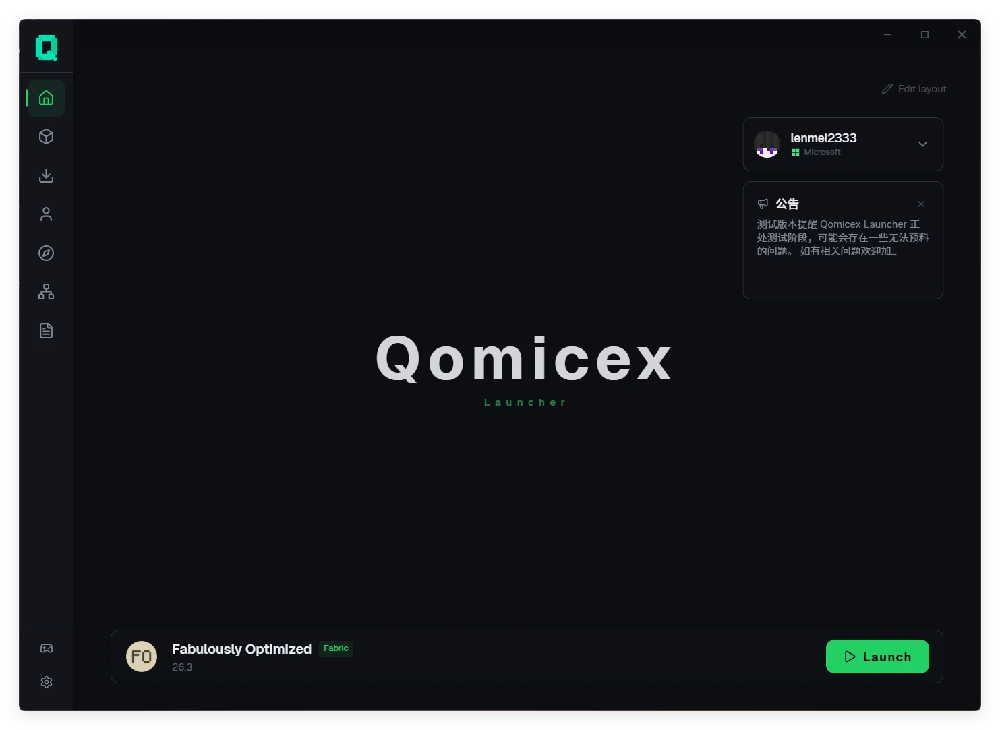</a>

</div>

---

## 概要

| 項目 | 内容 |
|:---|:---|
| 対応 OS | Windows、macOS、Linux（x64 と ARM64） |
| ローダー | Vanilla、Forge、NeoForge、Fabric、Quilt、LiteLoader、OptiFine、Cleanroom |
| コンテンツ | Modrinth、CurseForge、FTB、Technic、MC百科 |
| 言語 | 簡体字中国語、繁体字中国語、English、日本語、Русский |
| インストーラー | Windows 版は約 19 MB |

---

## 主な機能

### プラグイン

サードパーティ製プラグインをインストールして、画面と機能を拡張できます。

- プラグインは独立したページ、オーバーレイ、メニュー項目、テーマ、ダッシュボードウィジェットを追加できます
- プラグインストアで閲覧、インストール、更新、評価ができます
- プラグイン開発用のコンポーネントライブラリとコマンドラインツールを提供しています

### ワールドプレビュー

ゲームを起動せずにセーブデータの内容を確認できます。

- **マッププレビュー**：探索済みの範囲を描画し、高さを指定して洞窟や地下構造を確認できます
- **ウェイポイント**：JourneyMap、Xaero's Minimap、VoxelMap のウェイポイントとプレイヤー位置を表示します
- **投影プレビュー**：`.litematic` ファイルを 3D で表示し、レイヤー単位の切り取りと素材の集計ができます
- **ワールド設定**：ワールド名、ゲームモード、難易度、チート、ハードコアを変更できます

### マルチプレイ

- P2P 方式のマルチプレイに対応し、グローバル IP やポート開放は不要です。ルームコードで参加します
- ホストはメンバー一覧の確認とメンバーの削除ができます
- 他のランチャーを利用しているプレイヤーと同じルームで遊べます

### インスタンスとアカウント

- インスタンスは互いに分離され、MOD、セーブデータ、設定、起動引数を個別に保存します
- インスタンスのグループ化、アイコンの変更、インポートとエクスポートに対応しています
- Microsoft アカウント、LittleSkin、オフラインアカウントに対応しています
- 起動前に Java の実行環境を確認し、見つからない場合はダウンロードできます

### リソースとダウンロード

- ランチャー内で MOD、MOD パック、リソースパック、シェーダーを検索してインストールできます
- MOD のインストール時に必要な前提 MOD を検出して自動で導入します
- バニラのリソースと MOD ファイルでダウンロード元を個別に選択できます
- 複数スレッドによる分割ダウンロードに対応し、一時停止と再開ができます
- システムプロキシと任意のプロキシに対応しています

### MOD パック

- CurseForge、Modrinth、FTB、Technic、MultiMC の MOD パックをインポートできます
- CurseForge zip または Modrinth mrpack としてエクスポートできます
- MOD パックの更新に失敗した場合は自動で元に戻り、インスタンスは削除されません

### 外観

- ダーク、ライト、システム連動の 3 種類のテーマ
- アクセントカラーの変更、すりガラスとリキッドグラスの質感
- 画像、アニメーション画像、動画の背景
- カスタムフォントとテーマパック
- ダッシュボードのウィジェットを自由に配置できます

### その他

- **クラッシュ解析**：ログを貼り付けると問題の種類ごとに分類し、関連する MOD を特定します
- **MOD の更新**：インストール済み MOD の新しいバージョンをまとめて確認します
- **お気に入り**：フォルダ、メモ、タグを付けられ、まとめてインストールできます
- **ログ**：起動中のログをリアルタイムで表示し、自動保存と書き出しに対応しています
- **自動更新**：バックグラウンドで取得し、次回起動時に更新します
- **ページ共有**：`qomicex-launcher://` リンクからインスタンスを直接開けます
- **ローカルデータ**：設定とインスタンスはローカルに保存され、バックアップや移行ができます

---

## スクリーンショット

| インスタンス管理 | リソースセンター |
|:---:|:---:|
| 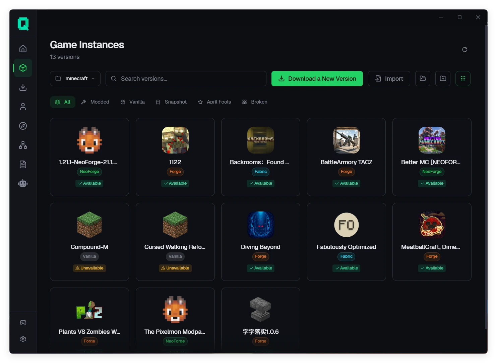 | 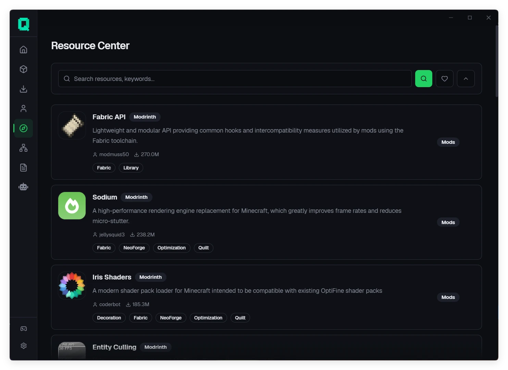 |
| インスタンスを分離し、設定とグループを個別に管理 | Modrinth、CurseForge、FTB、Technic をまとめて検索 |

| インスタンス詳細 | ダウンロード管理 |
|:---:|:---:|
| 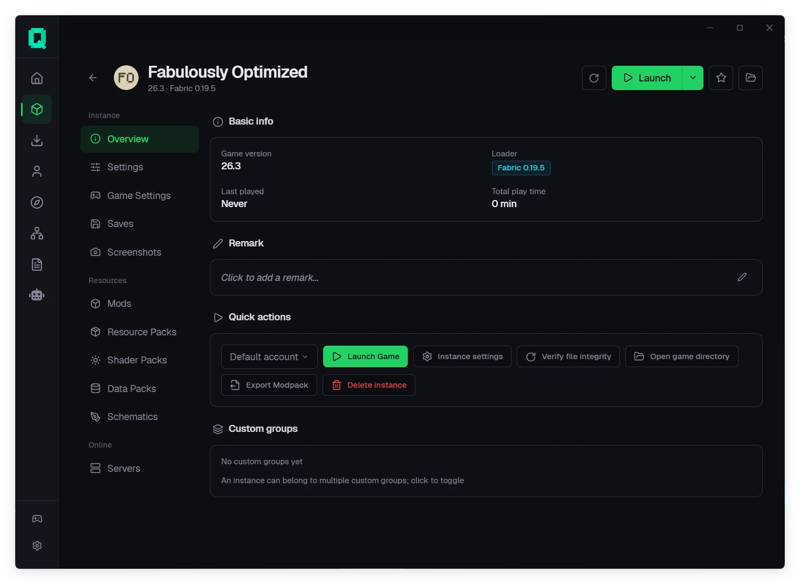 | 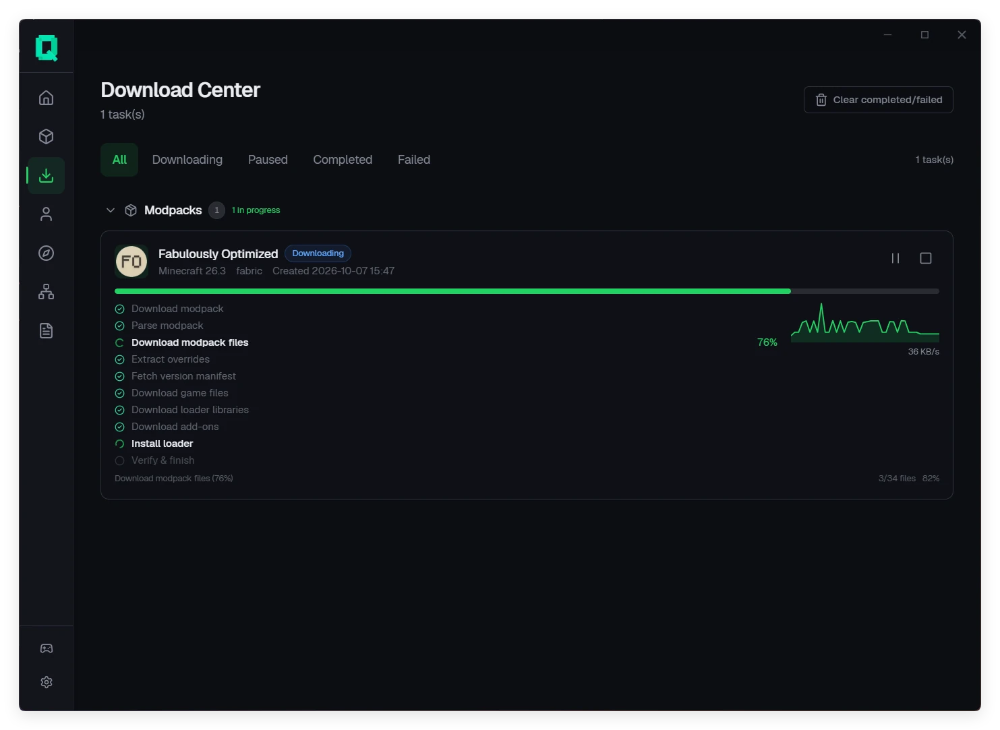 |
| MOD、セーブデータ、シェーダー、投影、サーバーの管理 | 進捗表示、一時停止と再開、再試行 |

| マッププレビュー | ワールド設定 |
|:---:|:---:|
| 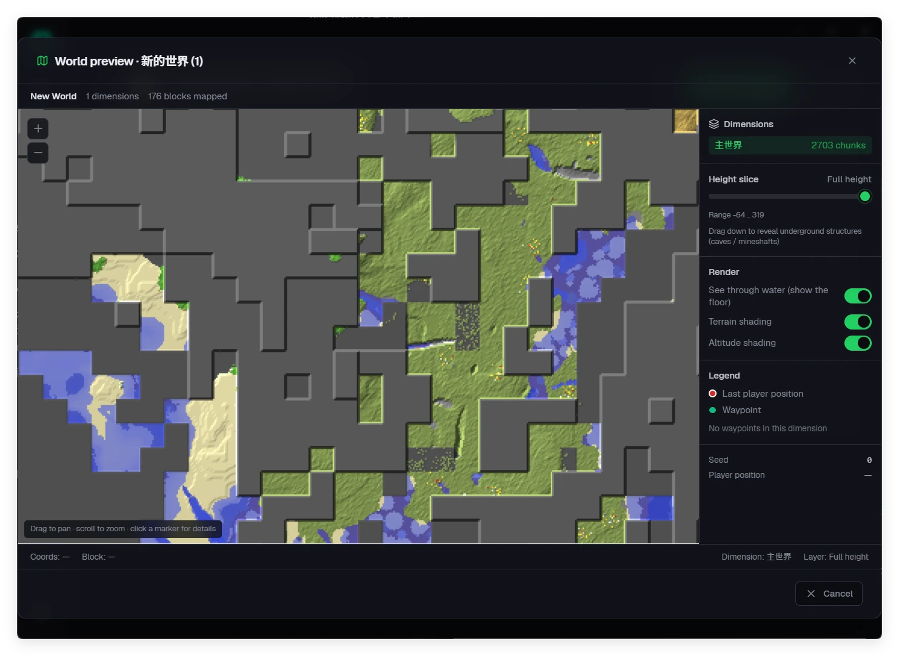 | 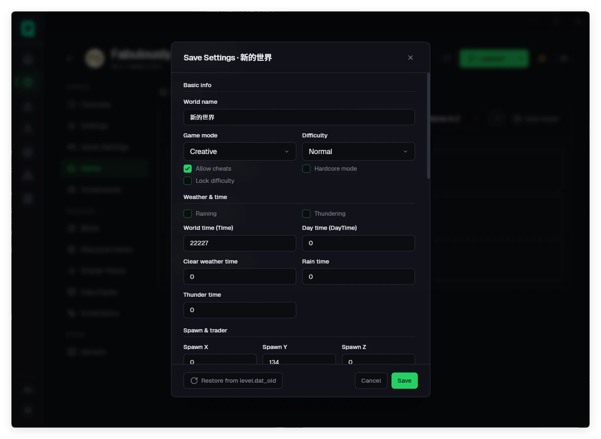 |
| 探索済み範囲の描画と高さの切り替え | `level.dat` を直接編集 |

| 投影プレビュー | 前提 MOD の導入 |
|:---:|:---:|
| 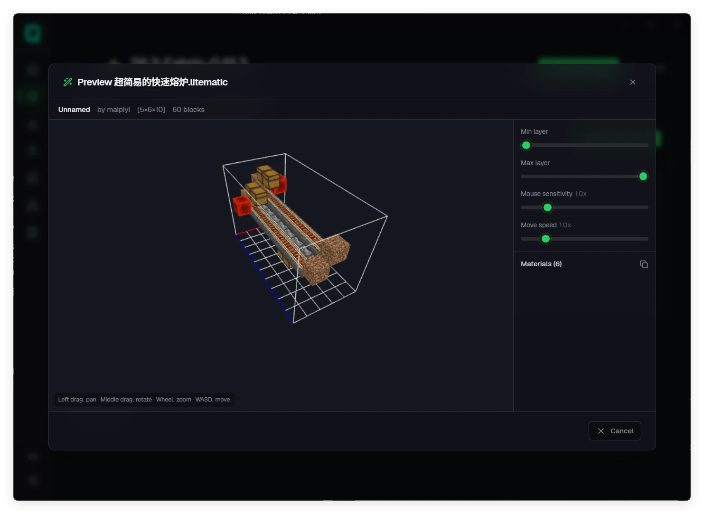 | 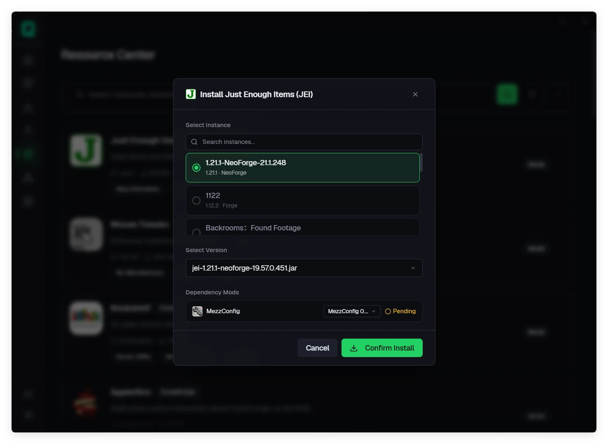 |
| `.litematic` の 3D 表示と素材の集計 | 前提 MOD を検出して自動で導入 |

| マルチプレイ | アカウント管理 |
|:---:|:---:|
| 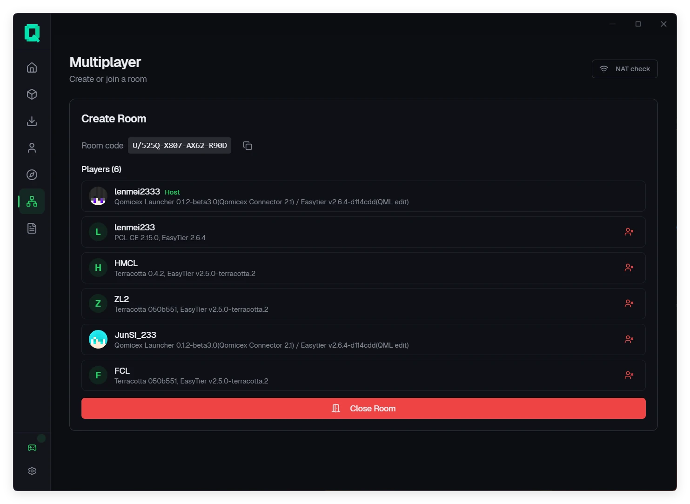 | 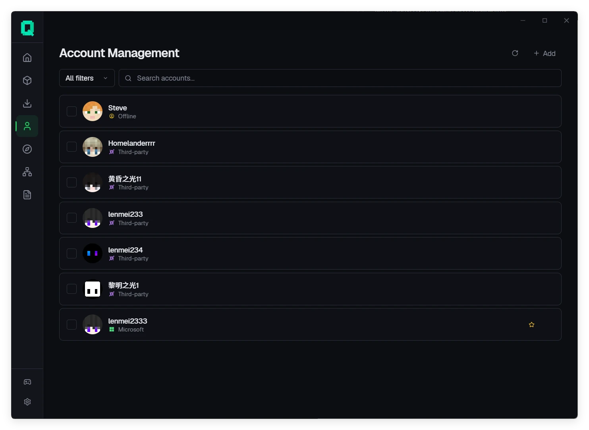 |
| ルームコードで参加し、メンバーを管理 | 複数のアカウント形式に対応 |

| バージョン一覧 | ゲーム設定 |
|:---:|:---:|
| 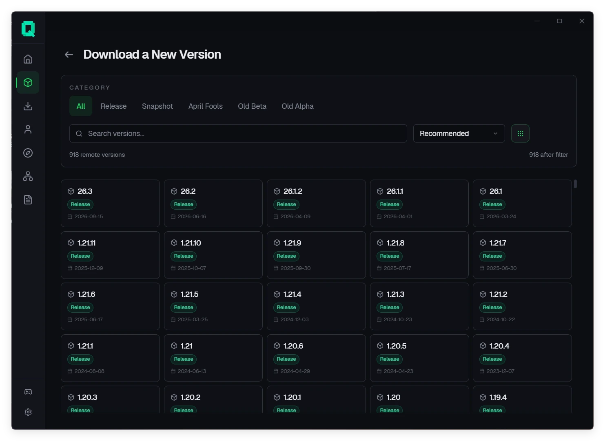 | 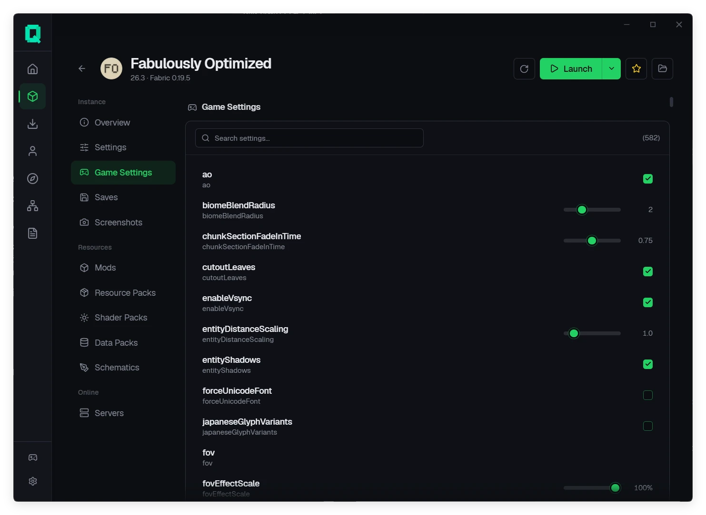 |
| リリース種別とローダーで絞り込み | 検索しながらゲーム設定を編集 |

---

## 対応プラットフォーム

| プラットフォーム | アーキテクチャ | 最小要件 | パッケージ |
|:---|:---|:---|:---|
| **Windows** | `x64`, `ARM64` | Windows 10 (1809+) | `.exe` |
| **macOS** | `x64`, `ARM64` | macOS 10.15+ | `.dmg` |
| **Linux** | `x64`, `ARM64` | Ubuntu 20.04+ / glibc 2.28+ | `.AppImage`、`.deb`、`.rpm` |

---

## ダウンロード

[公式ダウンロードページ](https://www.qomicex.top/download)または [GitHub Releases](https://github.com/Qomicex-Public/Qomicex.Tauri/releases/latest) から、お使いのプラットフォーム向けのインストーラーを取得してください。

- 安定版とベータ版は別のチャンネルで公開され、設定から切り替えられます
- ランチャーは自動で更新されます
- Windows では WebView2 ランタイムが必要です（Windows 11 には同梱されています）

---

## ソースからのビルド

Node.js 22+、pnpm 11+、および `rust-toolchain.toml` で固定された Rust ツールチェーンが必要です。

```bash
pnpm install --frozen-lockfile
pnpm --filter @qomicex/plugin-ui build
pnpm run tauri dev     # 開発
pnpm exec tauri build  # パッケージ
```

バックエンドは単独で起動できます。開発時、フロントエンドは `:5000` に直接接続します。

```bash
cargo run --manifest-path src-backend/qomicex-backend/Cargo.toml
```

開発規約とディレクトリ構成は [AGENTS.md](AGENTS.md) と [CONTRIBUTING.md](CONTRIBUTING.md) に記載しています。

---

## コントリビューション

- 不具合の報告や提案：[Issues](https://github.com/Qomicex-Public/Qomicex.Tauri/issues) へ、バージョン、OS、ログを添えてください
- プラグイン開発：[プラグイン API](docs/junsi-dev-docs/3-API规范/插件系统API.md)
- 翻訳：リポジトリ内の言語ファイルを参照してください
- 交流：[QQ グループ](https://qm.qq.com/q/rKiwzrkg8w)

---

## 関連プロジェクト

- **[qomicex-core-rust](https://github.com/Qomicex-Public/qomicex-core-rust)**：ランチャーの中核ロジック
- **[qomicex-downloader-rust](https://github.com/Qomicex-Public/qomicex-downloader-rust)**：ダウンロードエンジン
- **[qomicex-connector-rust](https://github.com/Qomicex-Public/qomicex-connector-rust)**：マルチプレイ通信
- **[EuoraCraft-Launcher](https://github.com/ECLteam/EuoraCraft-Launcher)**：ノード共有とランチャー間の相互接続

---

## Star 履歴

<a href="https://www.star-history.com/?repos=Qomicex-Public%2FQomicex.Tauri&type=date&legend=bottom-right">
 <picture>
   <source media="(prefers-color-scheme: dark)" srcset="https://api.star-history.com/chart?repos=Qomicex-Public/Qomicex.Tauri&type=date&theme=dark&legend=bottom-right&sealed_token=3kRKTiCGJWMYcUcMNuRameNqf5F2KOLMXywaK7Sxym5ZUX3u2Jh3yAam-_le6HA2Jb2oLupvmK1VlTarzTSBkPWaKb7z5gnA7hkq0ZLXwEaAxPsH1o0GQg" />
   <source media="(prefers-color-scheme: light)" srcset="https://api.star-history.com/chart?repos=Qomicex-Public/Qomicex.Tauri&type=date&legend=bottom-right&sealed_token=3kRKTiCGJWMYcUcMNuRameNqf5F2KOLMXywaK7Sxym5ZUX3u2Jh3yAam-_le6HA2Jb2oLupvmK1VlTarzTSBkPWaKb7z5gnA7hkq0ZLXwEaAxPsH1o0GQg" />
   
 </picture>
</a>

---

## コントリビューター

Qomicex Launcher に貢献してくださった皆様に感謝します。

<a href="https://github.com/Qomicex-Public/Qomicex.Tauri/graphs/contributors">
  
</a>

---

## 発音とライセンス

- **発音**：Qomicex `/kˈɑːmaɪsˌɛks/`（q·om·ic·ex）
- **ライセンス**：[GPLv3](LICENSE)

### 法的表記

- ゲームファイルは Mojang の公式サーバーおよび公開ミラーからダウンロードします。本プロジェクトは Minecraft 本体を保持・再配布しません。
- Qomicex Launcher はサードパーティ製ツールであり、Mojang、Microsoft、NetEase との提携・承認・スポンサー関係はありません。
- オフラインアカウントはオフラインプレイと自前サーバー向けです。認証を要求するサーバーでオフラインアカウントを使うと、そのサーバーの規約に違反する場合があります。
- オフラインまたはサードパーティのアカウントを追加する前に、Microsoft アカウントでのサインインが必要です。
