[English](README.md) | [简体中文](README-ZH_CN.md) | [繁體中文](README-ZH_TW.md) | [日本語](README-JA_JP.md) | **Русский**

<div align="center">


# Qomicex Launcher

**Minecraft-лаунчер с поддержкой плагинов**

Управление инстансами, загрузка ресурсов, просмотр миров и мультиплеер. Работает на Windows, macOS и Linux, распространяется под GPLv3.

[](https://github.com/Qomicex-Public/Qomicex.Tauri/)
[](https://github.com/Qomicex-Public/Qomicex.Tauri/releases)
[](https://github.com/Qomicex-Public/Qomicex.Tauri/releases)
[](https://github.com/Qomicex-Public/Qomicex.Tauri/releases)
[](https://github.com/Qomicex-Public/Qomicex.Tauri/actions)
[](LICENSE)

[**Скачать**](https://www.qomicex.top/download) · [Сайт](https://www.qomicex.top) · [Документация](https://docs.qomicex.top) · [Магазин плагинов](https://plugins.qomicex.top) · [QQ-группа](https://qm.qq.com/q/rKiwzrkg8w)

<a href="https://www.qomicex.top">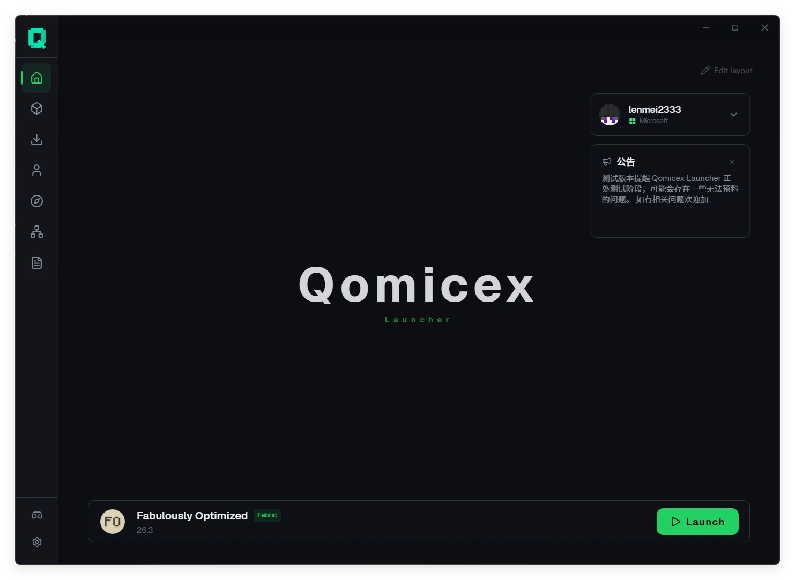</a>

</div>

---

## Обзор

| Параметр | Описание |
|:---|:---|
| Платформы | Windows, macOS, Linux, сборки для x64 и ARM64 |
| Загрузчики | Vanilla, Forge, NeoForge, Fabric, Quilt, LiteLoader, OptiFine, Cleanroom |
| Источники контента | Modrinth, CurseForge, FTB, Technic, MC百科 |
| Языки | упрощённый и традиционный китайский, English, 日本語, русский |
| Установщик | около 19 МБ для Windows |

---

## Возможности

### Плагины

Лаунчер поддерживает установку сторонних плагинов для расширения интерфейса и функций.

- Плагины добавляют отдельные страницы, оверлеи, пункты меню, темы и виджеты главной
- Магазин плагинов позволяет просматривать, устанавливать, обновлять и оценивать плагины
- Для разработки предоставляются библиотека компонентов и инструмент командной строки

### Просмотр миров

Содержимое сохранения можно посмотреть, не запуская игру.

- **Карта мира**: отображает исследованную часть сохранения, позволяет смотреть пещеры и подземные сооружения по высоте
- **Точки маршрута**: показывает метки JourneyMap, Xaero's Minimap и VoxelMap, а также позиции игроков
- **Просмотр схематик**: открывает файлы `.litematic` в 3D, обрезает по слоям и подсчитывает материалы
- **Настройки мира**: изменяет название мира, режим игры, сложность, читы и хардкор

### Мультиплеер

- P2P-подключение без внешнего IP-адреса и проброса портов, вход по коду комнаты
- Хост видит список участников и может удалять их
- Игроки с другими лаунчерами могут находиться в той же комнате

### Инстансы и аккаунты

- Инстансы изолированы: у каждого свои моды, сохранения, настройки и аргументы запуска
- Поддерживаются группы инстансов, свои иконки, импорт и экспорт
- Поддерживаются аккаунты Microsoft, LittleSkin и офлайн-аккаунты
- Перед запуском проверяется наличие Java, при отсутствии предлагается загрузка

### Ресурсы и загрузки

- Поиск и установка модов, сборок, наборов ресурсов и шейдеров прямо в лаунчере
- При установке мода необходимые зависимости определяются и ставятся автоматически
- Для ресурсов игры и файлов модов источник загрузки выбирается отдельно
- Многопоточная загрузка частями с паузой и продолжением
- Поддержка системного и собственного прокси

### Сборки

- Импорт сборок CurseForge, Modrinth, FTB, Technic и MultiMC
- Экспорт в CurseForge zip или Modrinth mrpack
- При неудачном обновлении сборки изменения откатываются, инстанс не удаляется

### Оформление

- Тёмная, светлая тема и режим следования системе
- Свой акцентный цвет, матовое и жидкое стекло
- Фоновые изображения, анимированные изображения и видео
- Свои шрифты и наборы тем
- Виджеты главной можно располагать свободно

### Прочее

- **Разбор крашей**: вставленный лог классифицируется по типу проблемы и указывает связанный мод
- **Обновления модов**: пакетная проверка новых версий установленных модов
- **Избранное**: папки, заметки и метки, установка целой группы
- **Логи**: вывод в реальном времени во время запуска, автоматическое сохранение и экспорт
- **Автообновление**: загрузка в фоне и установка при следующем запуске
- **Ссылки на страницы**: ссылка `qomicex-launcher://` открывает нужный инстанс
- **Локальные данные**: настройки и инстансы хранятся локально, их можно скопировать или перенести

---

## Скриншоты

| Инстансы | Центр ресурсов |
|:---:|:---:|
| 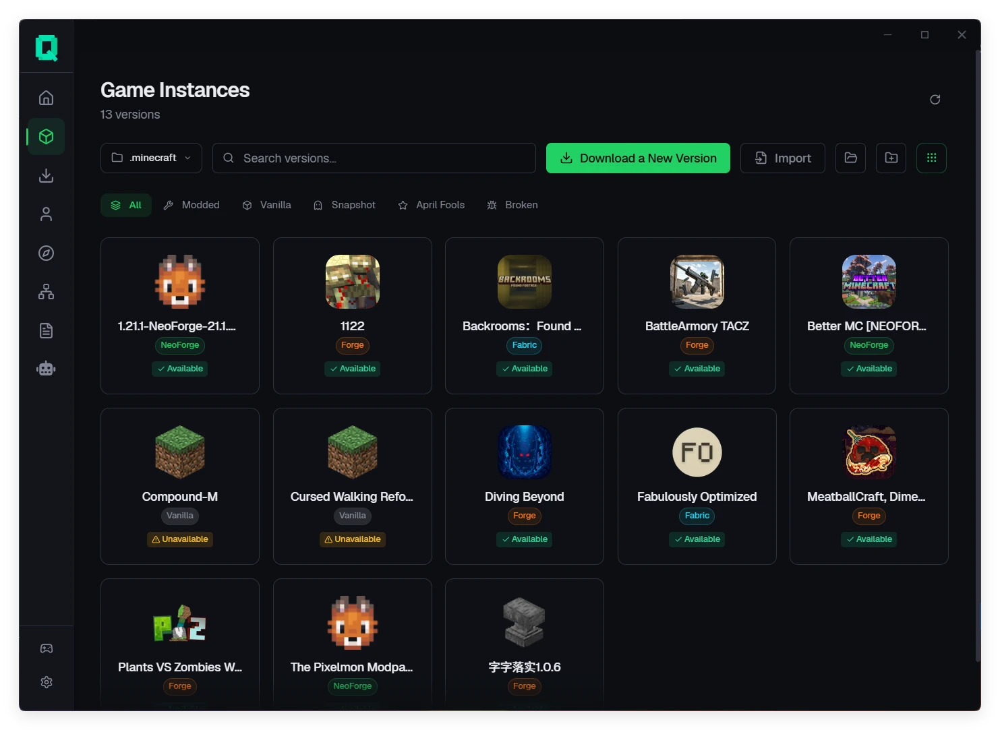 | 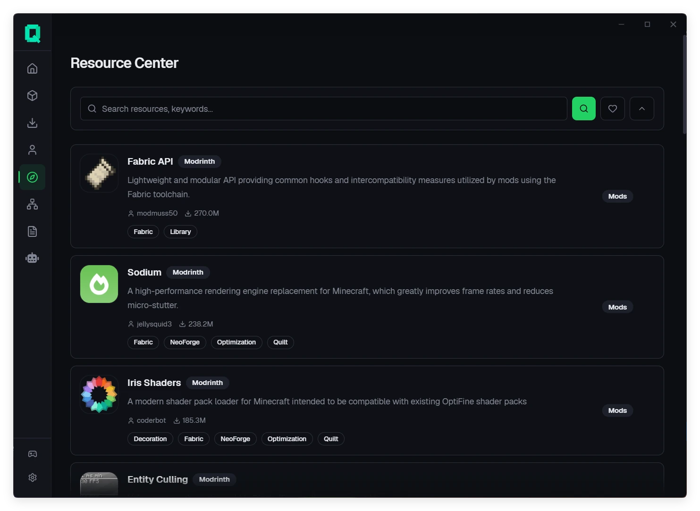 |
| Изоляция инстансов, свои настройки и группы | Единый поиск по Modrinth, CurseForge, FTB и Technic |

| Детали инстанса | Загрузки |
|:---:|:---:|
| 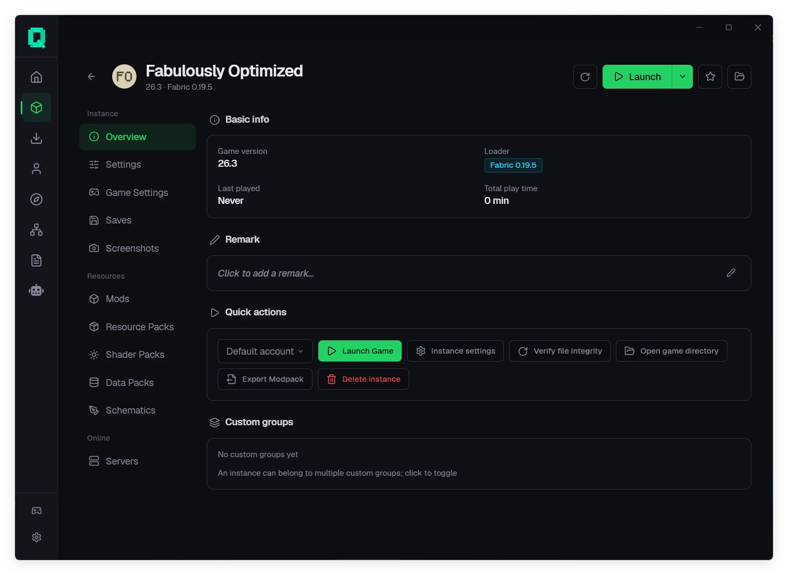 | 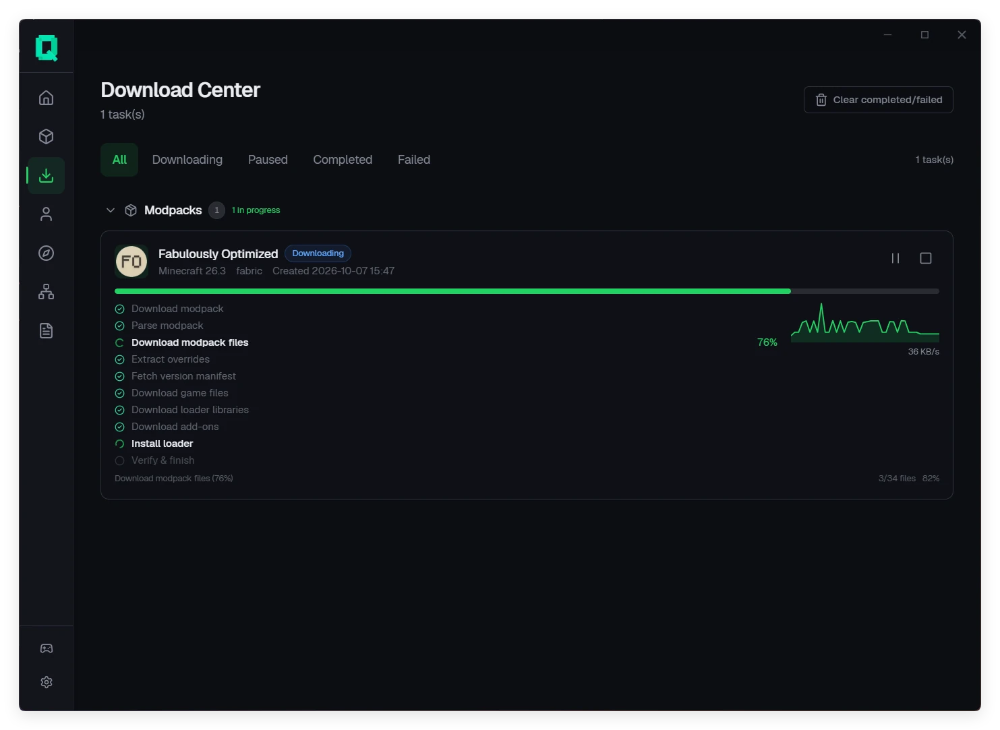 |
| Моды, сохранения, шейдеры, схематики и серверы | Прогресс, пауза и продолжение, повтор |

| Карта мира | Настройки мира |
|:---:|:---:|
| 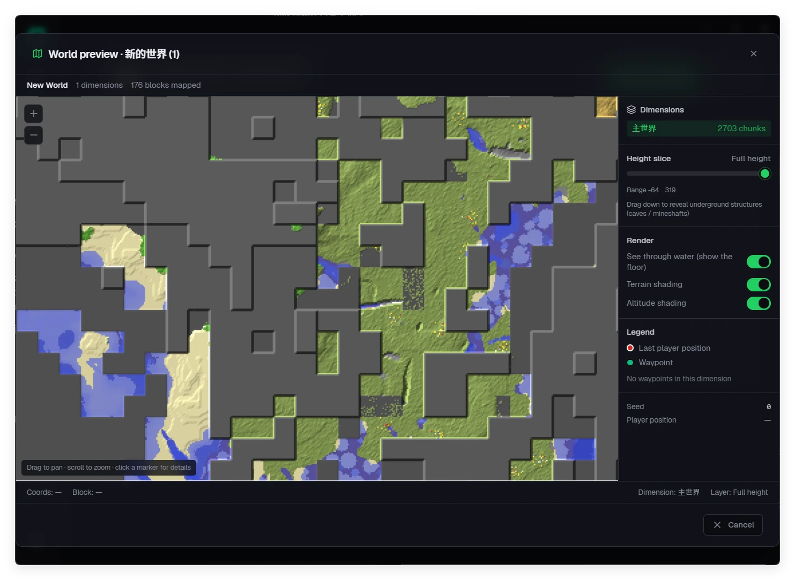 | 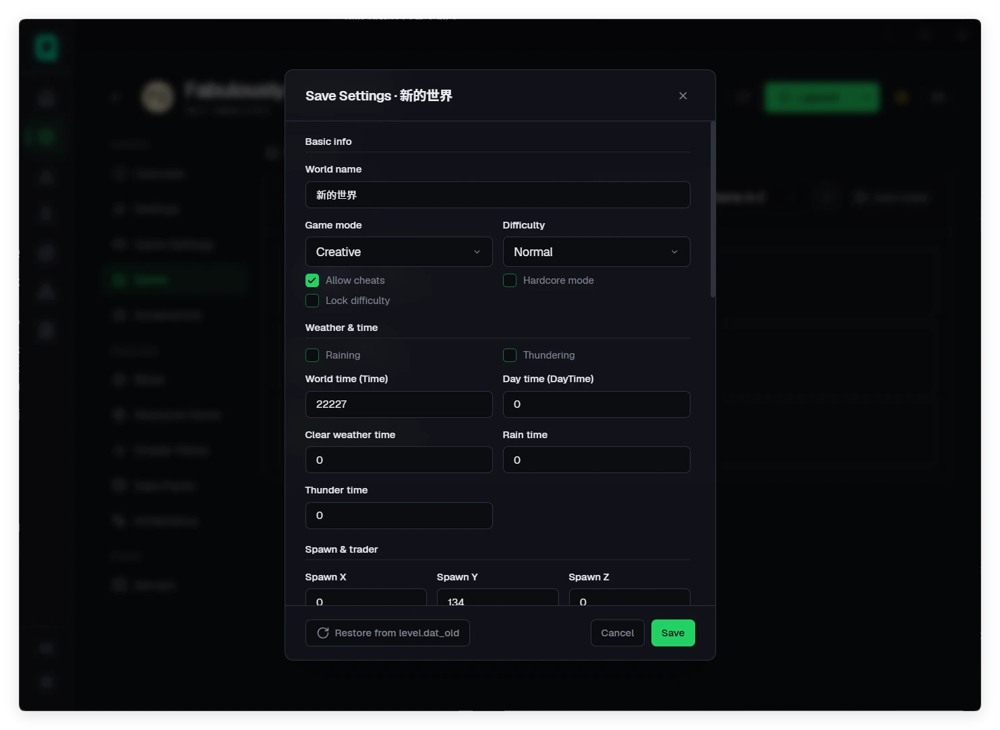 |
| Отрисовка исследованной области и срез по высоте | Прямое редактирование `level.dat` |

| Просмотр схематик | Зависимости модов |
|:---:|:---:|
| 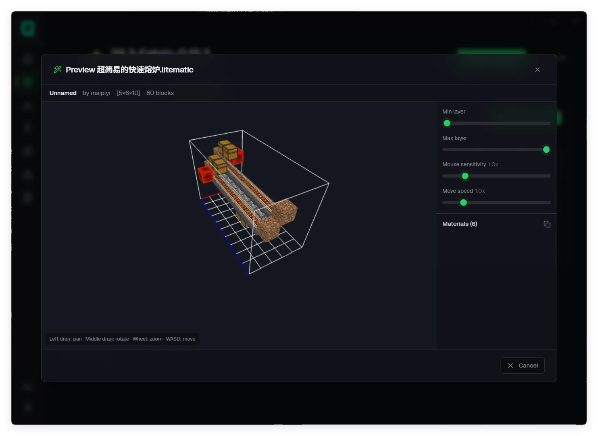 | 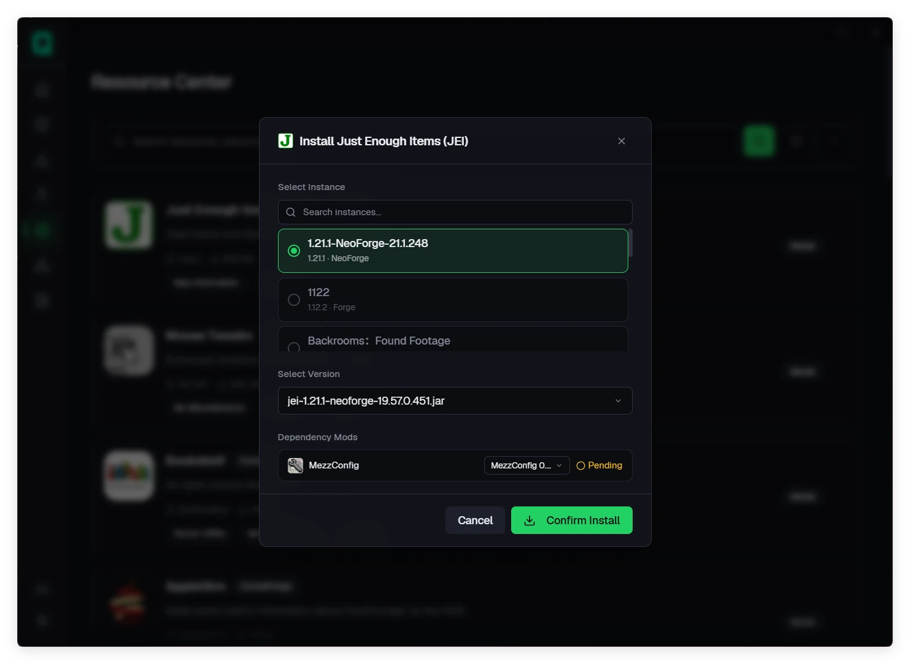 |
| 3D-просмотр `.litematic` и список материалов | Зависимости находятся и ставятся автоматически |

| Мультиплеер | Аккаунты |
|:---:|:---:|
| 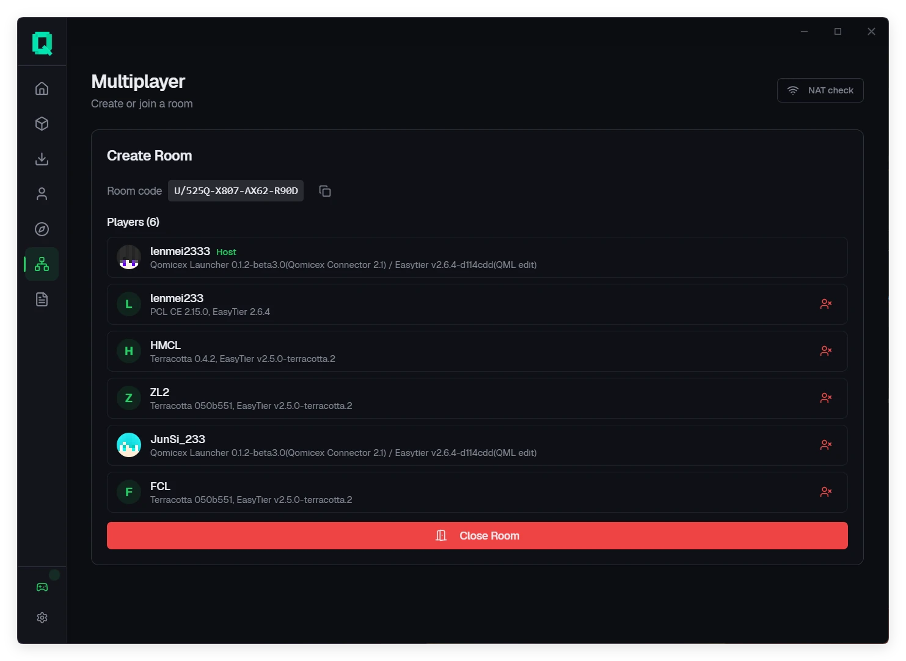 | 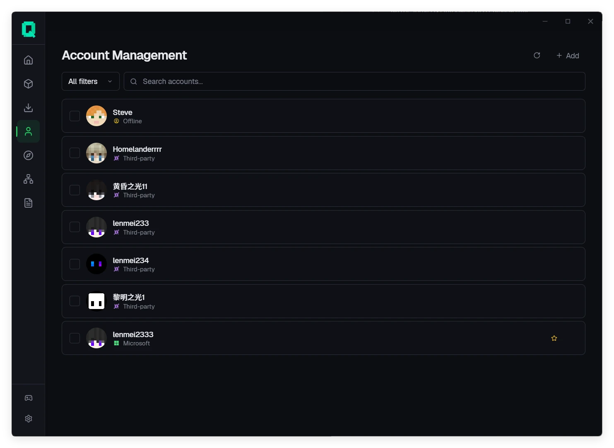 |
| Вход по коду комнаты и управление участниками | Несколько типов аккаунтов |

| Список версий | Настройки игры |
|:---:|:---:|
| 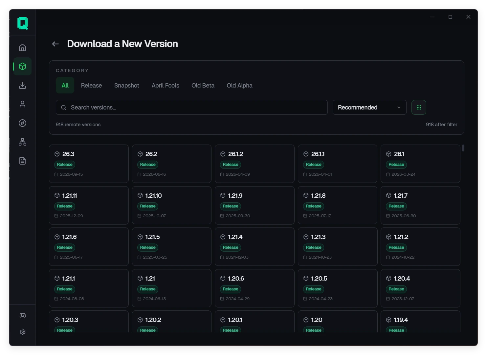 | 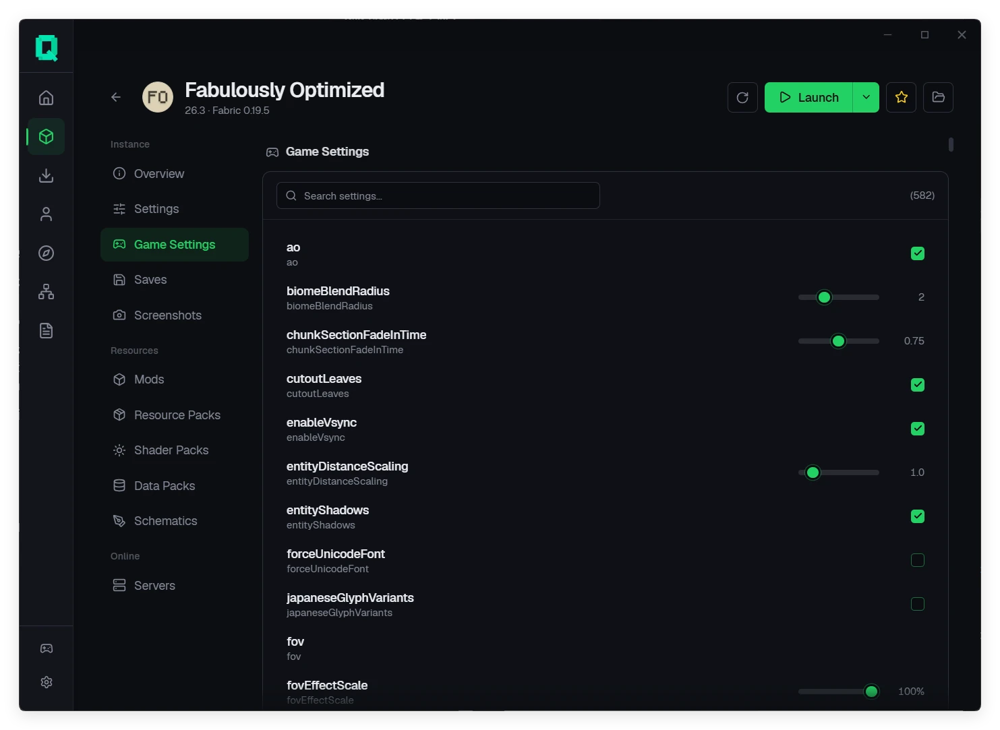 |
| Фильтры по типу версии и загрузчику | Редактирование настроек с поиском |

---

## Поддерживаемые платформы

| Платформа | Архитектуры | Минимальные требования | Пакет |
|:---|:---|:---|:---|
| **Windows** | `x64`, `ARM64` | Windows 10 (1809+) | `.exe` |
| **macOS** | `x64`, `ARM64` | macOS 10.15+ | `.dmg` |
| **Linux** | `x64`, `ARM64` | Ubuntu 20.04+ / glibc 2.28+ | `.AppImage`, `.deb`, `.rpm` |

---

## Загрузка

Установщик для своей платформы можно получить на [странице загрузки](https://www.qomicex.top/download) или в [GitHub Releases](https://github.com/Qomicex-Public/Qomicex.Tauri/releases/latest).

- Стабильные и тестовые версии публикуются в разных каналах, переключение в настройках
- Лаунчер обновляется автоматически
- В Windows требуется среда WebView2, в Windows 11 она уже есть

---

## Сборка из исходников

Нужны Node.js 22+, pnpm 11+ и инструментарий Rust, указанный в `rust-toolchain.toml`.

```bash
pnpm install --frozen-lockfile
pnpm --filter @qomicex/plugin-ui build
pnpm run tauri dev     # разработка
pnpm exec tauri build  # сборка пакета
```

Бэкенд можно запустить отдельно; при разработке фронтенд подключается к `:5000` напрямую.

```bash
cargo run --manifest-path src-backend/qomicex-backend/Cargo.toml
```

Соглашения разработки и структура каталогов описаны в [AGENTS.md](AGENTS.md) и [CONTRIBUTING.md](CONTRIBUTING.md).

---

## Участие

- Сообщения об ошибках и предложения: [Issues](https://github.com/Qomicex-Public/Qomicex.Tauri/issues), укажите версию, ОС и логи
- Разработка плагинов: [API плагинов](docs/junsi-dev-docs/3-API规范/插件系统API.md)
- Переводы: языковые файлы в репозитории
- Общение: [QQ-группа](https://qm.qq.com/q/rKiwzrkg8w)

---

## Связанные проекты

- **[qomicex-core-rust](https://github.com/Qomicex-Public/qomicex-core-rust)**: основная логика лаунчера
- **[qomicex-downloader-rust](https://github.com/Qomicex-Public/qomicex-downloader-rust)**: движок загрузки
- **[qomicex-connector-rust](https://github.com/Qomicex-Public/qomicex-connector-rust)**: сеть для мультиплеера
- **[EuoraCraft-Launcher](https://github.com/ECLteam/EuoraCraft-Launcher)**: общие узлы и совместимость между лаунчерами

---

## Star history

<a href="https://www.star-history.com/?repos=Qomicex-Public%2FQomicex.Tauri&type=date&legend=bottom-right">
 <picture>
   <source media="(prefers-color-scheme: dark)" srcset="https://api.star-history.com/chart?repos=Qomicex-Public/Qomicex.Tauri&type=date&theme=dark&legend=bottom-right&sealed_token=3kRKTiCGJWMYcUcMNuRameNqf5F2KOLMXywaK7Sxym5ZUX3u2Jh3yAam-_le6HA2Jb2oLupvmK1VlTarzTSBkPWaKb7z5gnA7hkq0ZLXwEaAxPsH1o0GQg" />
   <source media="(prefers-color-scheme: light)" srcset="https://api.star-history.com/chart?repos=Qomicex-Public/Qomicex.Tauri&type=date&legend=bottom-right&sealed_token=3kRKTiCGJWMYcUcMNuRameNqf5F2KOLMXywaK7Sxym5ZUX3u2Jh3yAam-_le6HA2Jb2oLupvmK1VlTarzTSBkPWaKb7z5gnA7hkq0ZLXwEaAxPsH1o0GQg" />
   
 </picture>
</a>

---

## Участники

Спасибо всем, кто внёс вклад в Qomicex Launcher.

<a href="https://github.com/Qomicex-Public/Qomicex.Tauri/graphs/contributors">
  
</a>

---

## Произношение и лицензия

- **Произношение**: Qomicex `/kˈɑːmaɪsˌɛks/` (q·om·ic·ex)
- **Лицензия**: [GPLv3](LICENSE)

### Правовая информация

- Файлы игры загружаются с официальных серверов Mojang и их публичных зеркал. Проект не размещает и не распространяет сам Minecraft.
- Qomicex Launcher — сторонний инструмент. Он не связан с Mojang, Microsoft и NetEase, не одобрен и не спонсируется ими.
- Офлайн-аккаунты предназначены для одиночной игры и собственных серверов. Использование офлайн-аккаунта на серверах с проверкой подлинности может нарушать их правила.
- Перед добавлением офлайн- или стороннего аккаунта нужно войти в аккаунт Microsoft.
