[English](README.md) | **简体中文** | [繁體中文](README-ZH_TW.md) | [日本語](README-JA_JP.md) | [Русский](README-RU_RU.md)

<div align="center">


# Qomicex Launcher

**支持插件扩展的 Minecraft 启动器**

实例管理、资源下载、存档预览与多人联机。支持 Windows、macOS 与 Linux，GPLv3 开源。

[](https://github.com/Qomicex-Public/Qomicex.Tauri/)
[](https://github.com/Qomicex-Public/Qomicex.Tauri/releases)
[](https://github.com/Qomicex-Public/Qomicex.Tauri/releases)
[](https://github.com/Qomicex-Public/Qomicex.Tauri/releases)
[](https://github.com/Qomicex-Public/Qomicex.Tauri/actions)
[](LICENSE)

[**下载**](https://www.qomicex.top/download) · [官网](https://www.qomicex.top) · [文档](https://docs.qomicex.top) · [插件商店](https://plugins.qomicex.top) · [QQ 群](https://qm.qq.com/q/rKiwzrkg8w) · [爱发电](https://afdian.com/a/QomicexLauncher)

<a href="https://www.qomicex.top">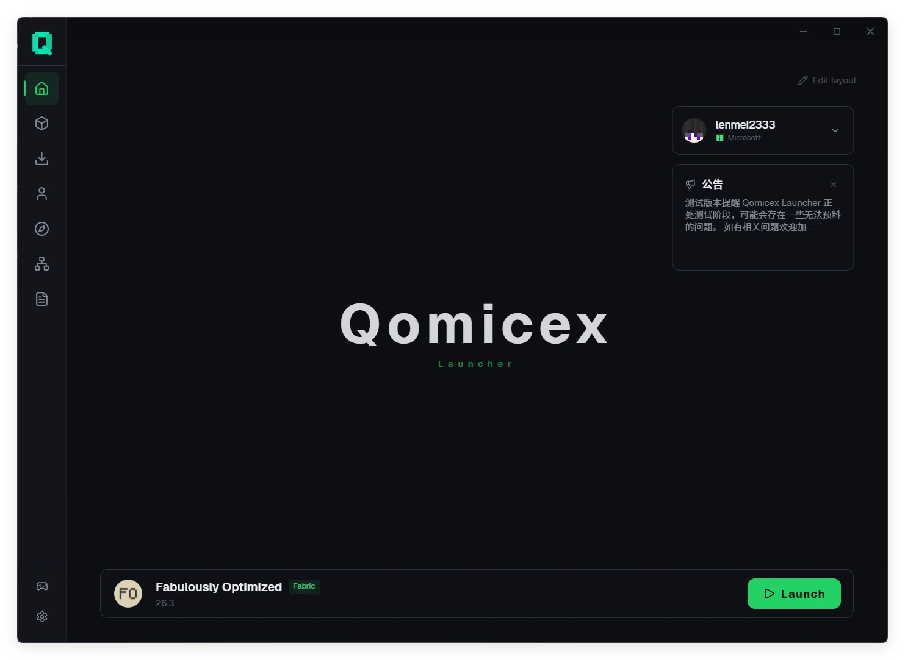</a>

</div>

---

## 概览

| 项目 | 说明 |
|:---|:---|
| 平台 | Windows、macOS、Linux，提供 x64 与 ARM64 版本 |
| 加载器 | 原版、Forge、NeoForge、Fabric、Quilt、LiteLoader、OptiFine、Cleanroom |
| 资源平台 | Modrinth、CurseForge、FTB、Technic、MC百科 |
| 语言 | 简体中文、繁體中文、English、日本語、Русский |
| 安装包 | Windows 版约 19 MB |

---

## 主要功能

### 插件扩展

启动器支持安装第三方插件，用于扩展界面与功能。

- 插件可添加独立页面、悬浮窗、菜单项、主题与主页组件
- 插件商店提供浏览、安装、更新与评分
- 提供插件开发组件库与命令行工具，便于开发和调试

### 存档预览

无需启动游戏即可查看存档内容。

- **地图预览**：显示存档中已探索的区域，可按高度查看洞穴与地下结构
- **路径点**：显示 JourneyMap、Xaero's Minimap 与 VoxelMap 的路径点及玩家位置
- **投影预览**：以 3D 方式查看 `.litematic` 文件，支持按层裁剪与材料统计
- **存档设置**：修改世界名称、游戏模式、难度、作弊与极限模式

### 多人联机

- P2P 联机，无需公网 IP 或端口映射，通过房间码加入
- 房主可查看成员列表并移除成员
- 支持与其他启动器的玩家在同一房间联机

### 实例与账户

- 实例相互隔离，分别保存模组、存档、配置与启动参数
- 支持实例分组、自定义图标与导入导出
- 支持 Microsoft 账户、LittleSkin 与离线账户
- 启动前检查 Java 运行环境，缺失时可下载

### 资源与下载

- 在启动器中搜索并安装模组、整合包、资源包与光影
- 安装模组时自动检测并安装前置依赖
- 原版资源与模组文件可分别选择下载源
- 多线程分段下载，支持暂停与续传
- 支持系统代理与自定义代理

### 整合包

- 导入 CurseForge、Modrinth、FTB、Technic 与 MultiMC 整合包
- 导出为 CurseForge zip 或 Modrinth mrpack
- 整合包更新失败时自动回滚，不删除原实例

### 外观与界面

- 深色、浅色与跟随系统三种模式
- 自定义主题色，毛玻璃与液态玻璃材质
- 图片、动图与视频背景
- 自定义字体与主题包
- 主页组件可自由排列

### 其他

- **崩溃分析**：粘贴日志后按问题类型分类，并定位到相关模组
- **模组更新**：批量检查已安装模组的新版本
- **收藏夹**：分组、备注与标签，可整组安装
- **日志**：启动过程实时显示，日志自动保存并可导出
- **自动更新**：后台下载，下次启动时完成更新
- **页面分享**：通过 `qomicex-launcher://` 链接直接打开实例
- **本地数据**：配置与实例保存在本地，可直接备份与迁移

---

## 截图

| 实例管理 | 资源中心 |
|:---:|:---:|
| 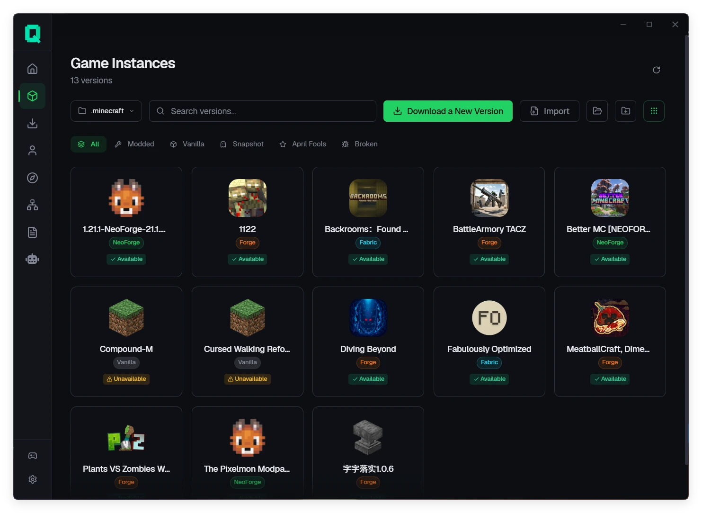 | 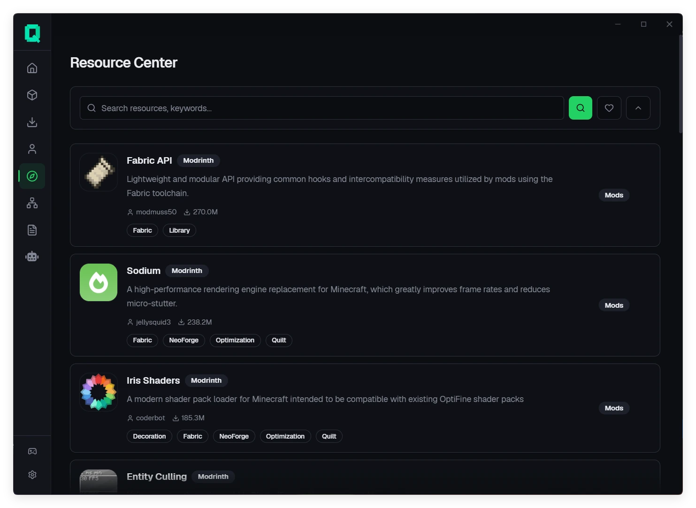 |
| 实例隔离，独立配置与分组 | Modrinth、CurseForge、FTB、Technic 统一搜索 |

| 实例详情 | 下载管理 |
|:---:|:---:|
| 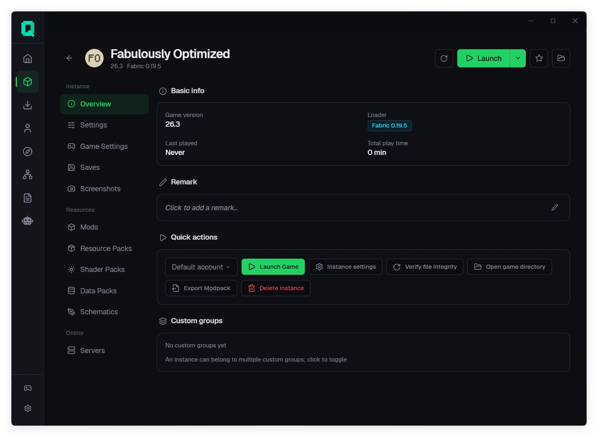 | 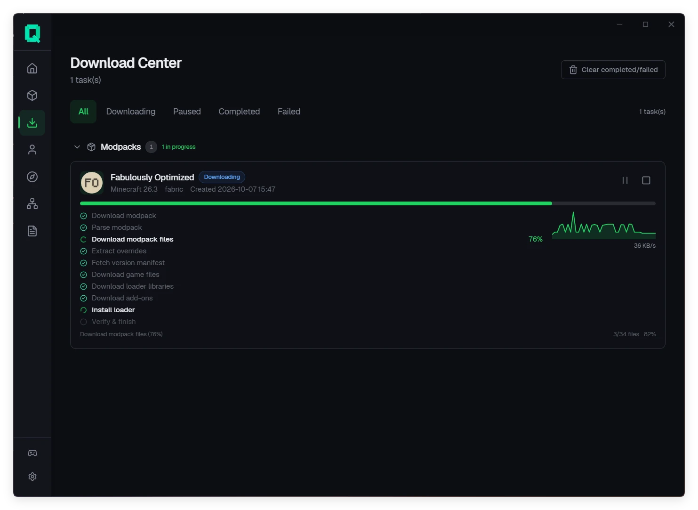 |
| 模组、存档、光影、投影与服务器管理 | 下载进度、暂停续传与失败重试 |

| 地图预览 | 存档设置 |
|:---:|:---:|
| 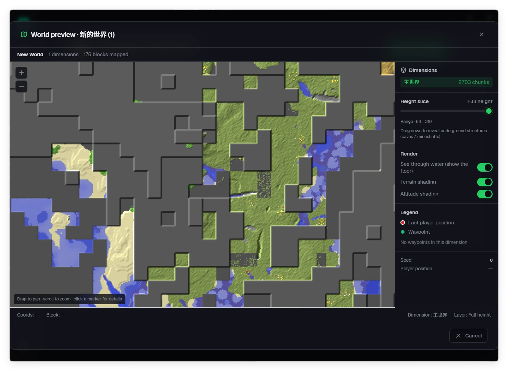 | 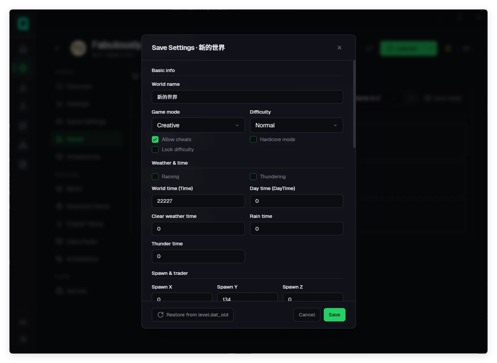 |
| 已探索区域与地下结构 | 直接修改 `level.dat` |

| 投影预览 | 前置依赖安装 |
|:---:|:---:|
| 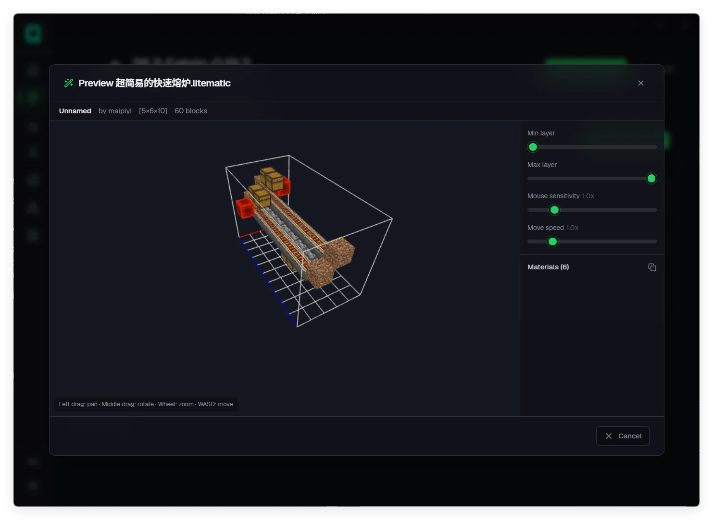 | 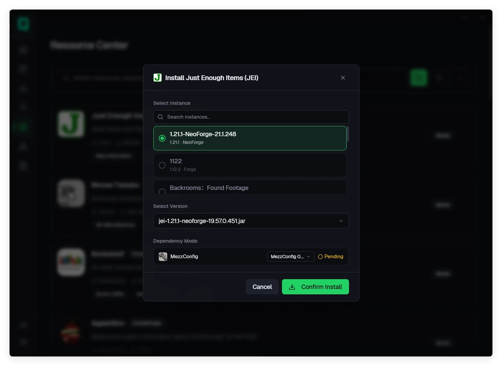 |
| `.litematic` 3D 预览与材料统计 | 自动检测并安装模组前置 |

| 多人联机 | 账户管理 |
|:---:|:---:|
| 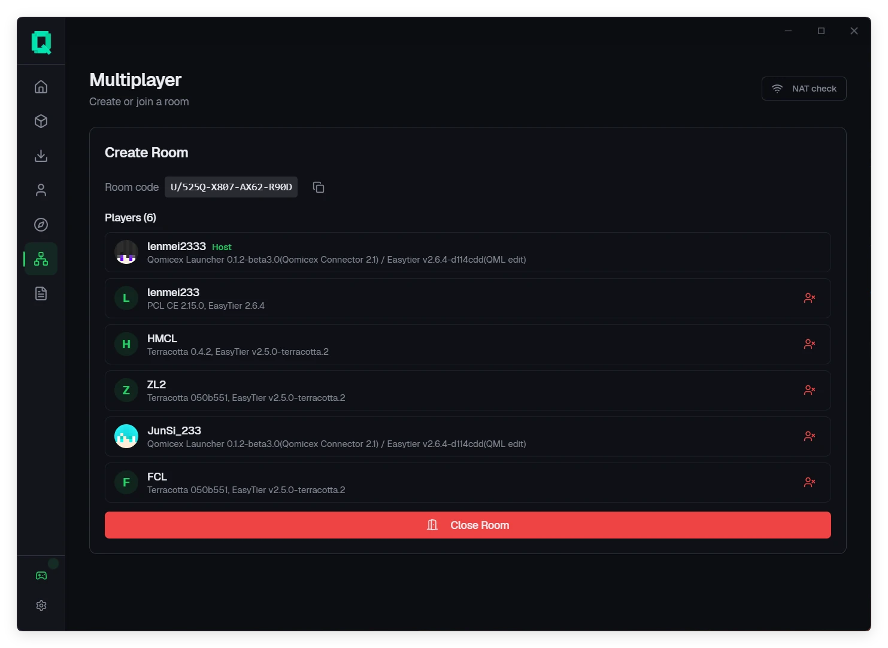 | 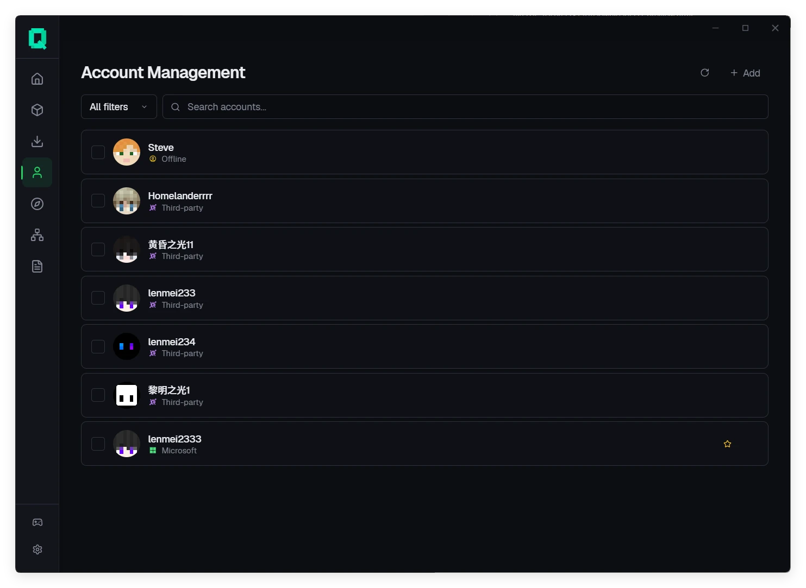 |
| 房间码加入，成员管理 | 支持多种账户类型 |

| 版本列表 | 游戏设置 |
|:---:|:---:|
| 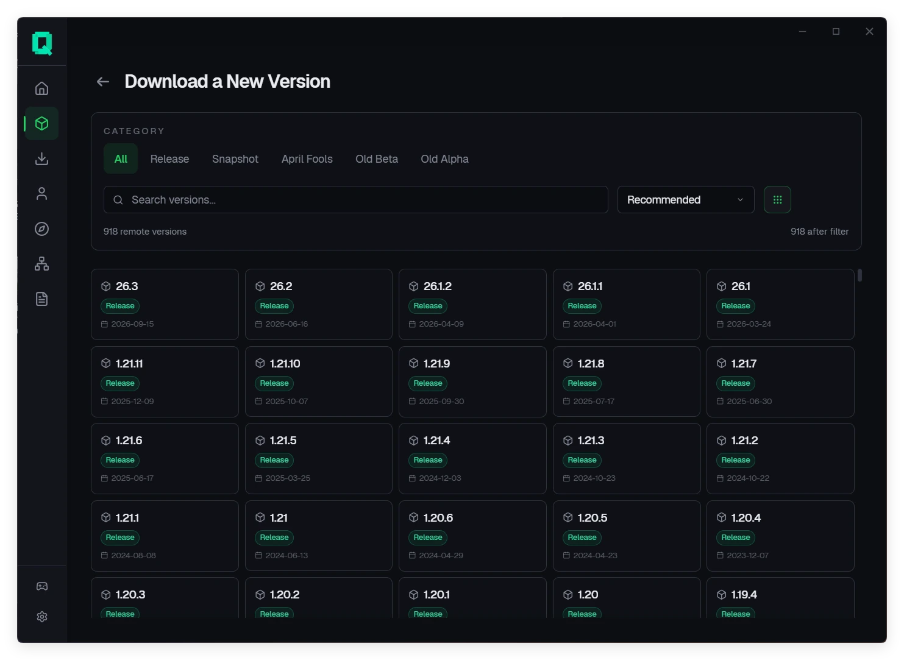 | 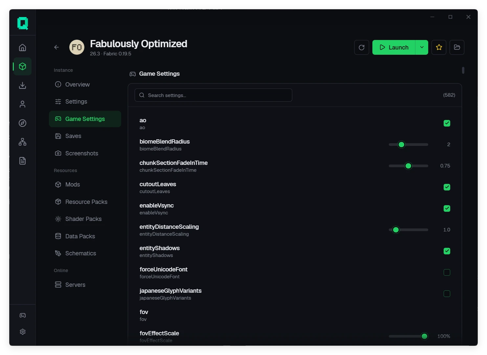 |
| 按版本类型与加载器筛选 | 搜索式编辑游戏设置 |

---

## 支持平台

| 平台 | 架构 | 最低系统要求 | 安装包 |
|:---|:---|:---|:---|
| **Windows** | `x64`, `ARM64` | Windows 10 (1809+) | `.exe` |
| **macOS** | `x64`, `ARM64` | macOS 10.15+ | `.dmg` |
| **Linux** | `x64`, `ARM64` | Ubuntu 20.04+ / glibc 2.28+ | `.AppImage`、`.deb`、`.rpm` |

---

## 下载

从[官网下载页](https://www.qomicex.top/download)或 [GitHub Releases](https://github.com/Qomicex-Public/Qomicex.Tauri/releases/latest) 获取对应平台的安装包。

- 正式版与测试版分通道发布，可在设置中切换
- 启动器支持自动更新
- Windows 需要 WebView2 运行时，Windows 11 已内置

---

## 从源码构建

需要 Node.js 22+、pnpm 11+，以及 `rust-toolchain.toml` 指定的 Rust 工具链。

```bash
pnpm install --frozen-lockfile
pnpm --filter @qomicex/plugin-ui build
pnpm run tauri dev     # 开发
pnpm exec tauri build  # 打包
```

后端可单独启动，开发时前端通过 `:5000` 直连：

```bash
cargo run --manifest-path src-backend/qomicex-backend/Cargo.toml
```

开发约定与目录结构见 [AGENTS.md](AGENTS.md) 与 [CONTRIBUTING.md](CONTRIBUTING.md)。

---

## 参与贡献

- 提交问题或功能建议：[Issues](https://github.com/Qomicex-Public/Qomicex.Tauri/issues)，请附版本号、系统版本与日志
- 开发插件：[插件系统 API](docs/junsi-dev-docs/3-API规范/插件系统API.md)
- 参与翻译：见仓库内的语言文件
- 交流反馈：[QQ 群](https://qm.qq.com/q/rKiwzrkg8w)

---

## 关联项目

- **[qomicex-core-rust](https://github.com/Qomicex-Public/qomicex-core-rust)**：启动器核心逻辑
- **[qomicex-downloader-rust](https://github.com/Qomicex-Public/qomicex-downloader-rust)**：下载引擎
- **[qomicex-connector-rust](https://github.com/Qomicex-Public/qomicex-connector-rust)**：联机网络
- **[EuoraCraft-Launcher](https://github.com/ECLteam/EuoraCraft-Launcher)**：共享联机节点，跨启动器互通

---

## Star 增长趋势

<a href="https://www.star-history.com/?repos=Qomicex-Public%2FQomicex.Tauri&type=date&legend=bottom-right">
 <picture>
   <source media="(prefers-color-scheme: dark)" srcset="https://api.star-history.com/chart?repos=Qomicex-Public/Qomicex.Tauri&type=date&theme=dark&legend=bottom-right&sealed_token=3kRKTiCGJWMYcUcMNuRameNqf5F2KOLMXywaK7Sxym5ZUX3u2Jh3yAam-_le6HA2Jb2oLupvmK1VlTarzTSBkPWaKb7z5gnA7hkq0ZLXwEaAxPsH1o0GQg" />
   <source media="(prefers-color-scheme: light)" srcset="https://api.star-history.com/chart?repos=Qomicex-Public/Qomicex.Tauri&type=date&legend=bottom-right&sealed_token=3kRKTiCGJWMYcUcMNuRameNqf5F2KOLMXywaK7Sxym5ZUX3u2Jh3yAam-_le6HA2Jb2oLupvmK1VlTarzTSBkPWaKb7z5gnA7hkq0ZLXwEaAxPsH1o0GQg" />
   
 </picture>
</a>

---

## 贡献者

感谢所有为 Qomicex Launcher 做出贡献的人。

<a href="https://github.com/Qomicex-Public/Qomicex.Tauri/graphs/contributors">
  
</a>

---

## 发音与许可

- **读音**：Qomicex `/kˈɑːmaɪsˌɛks/`（q·om·ic·ex）
- **许可**：[GPLv3](LICENSE)

### 合规声明

- 游戏文件从 Mojang 官方服务器及其公开镜像下载。本项目不托管、不转存 Minecraft 游戏本体。
- Qomicex Launcher 是第三方工具，与 Mojang、Microsoft、网易无隶属、背书或赞助关系。
- 离线账户仅用于离线游戏与自建服务器。在要求正版验证的服务器上使用离线账户可能违反该服务器的规则。
- 添加离线账户或第三方账户前，需先登录 Microsoft 账户。
