[English](README.md) | [简体中文](README-ZH_CN.md) | **繁體中文** | [日本語](README-JA_JP.md) | [Русский](README-RU_RU.md)

<div align="center">


# Qomicex Launcher

**支援外掛擴充的 Minecraft 啟動器**

實例管理、資源下載、存檔預覽與多人連線。支援 Windows、macOS 與 Linux，GPLv3 開源。

[](https://github.com/Qomicex-Public/Qomicex.Tauri/)
[](https://github.com/Qomicex-Public/Qomicex.Tauri/releases)
[](https://github.com/Qomicex-Public/Qomicex.Tauri/releases)
[](https://github.com/Qomicex-Public/Qomicex.Tauri/releases)
[](https://github.com/Qomicex-Public/Qomicex.Tauri/actions)
[](LICENSE)

[**下載**](https://www.qomicex.top/download) · [官方網站](https://www.qomicex.top) · [文件](https://docs.qomicex.top) · [外掛商店](https://plugins.qomicex.top) · [QQ 群](https://qm.qq.com/q/rKiwzrkg8w) · [愛發電](https://afdian.com/a/QomicexLauncher)

<a href="https://www.qomicex.top">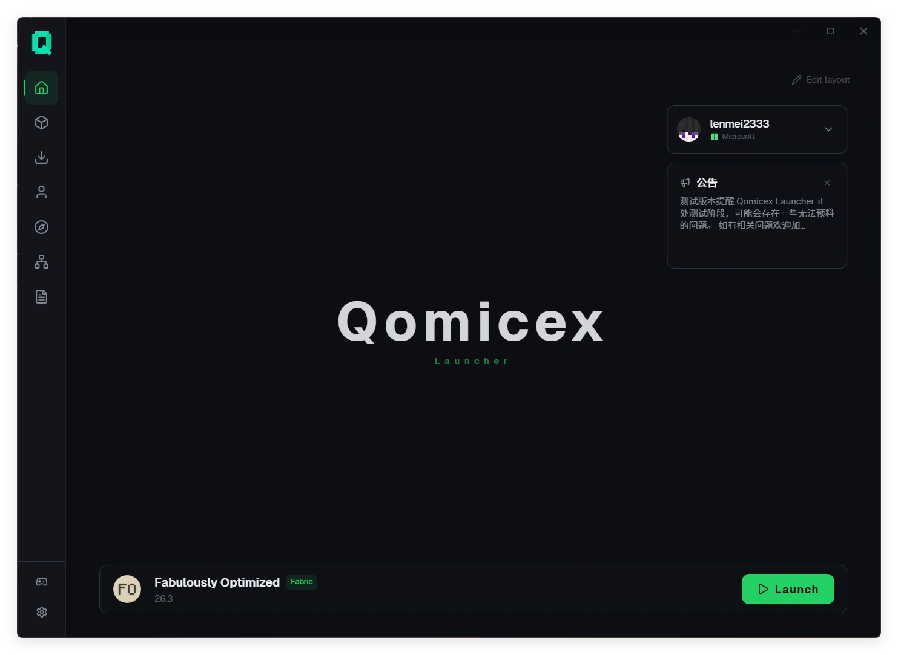</a>

</div>

---

## 概覽

| 項目 | 說明 |
|:---|:---|
| 平台 | Windows、macOS、Linux，提供 x64 與 ARM64 版本 |
| 載入器 | 原版、Forge、NeoForge、Fabric、Quilt、LiteLoader、OptiFine、Cleanroom |
| 資源平台 | Modrinth、CurseForge、FTB、Technic、MC百科 |
| 語言 | 简体中文、繁體中文、English、日本語、Русский |
| 安裝檔 | Windows 版約 19 MB |

---

## 主要功能

### 外掛擴充

啟動器支援安裝第三方外掛，用於擴充介面與功能。

- 外掛可新增獨立頁面、懸浮視窗、選單項目、主題與主頁元件
- 外掛商店提供瀏覽、安裝、更新與評分
- 提供外掛開發元件庫與命令列工具，便於開發與除錯

### 存檔預覽

無需啟動遊戲即可檢視存檔內容。

- **地圖預覽**：顯示存檔中已探索的區域，可依高度檢視洞穴與地下結構
- **路徑點**：顯示 JourneyMap、Xaero's Minimap 與 VoxelMap 的路徑點及玩家位置
- **投影預覽**：以 3D 方式檢視 `.litematic` 檔案，支援依層裁切與材料統計
- **存檔設定**：修改世界名稱、遊戲模式、難度、作弊與極限模式

### 多人連線

- P2P 連線，無需公網 IP 或連接埠轉發，透過房間碼加入
- 房主可檢視成員列表並移除成員
- 支援與其他啟動器的玩家在同一房間連線

### 實例與帳號

- 實例相互隔離，分別保存模組、存檔、設定與啟動參數
- 支援實例分組、自訂圖示與匯入匯出
- 支援 Microsoft 帳號、LittleSkin 與離線帳號
- 啟動前檢查 Java 執行環境，缺少時可下載

### 資源與下載

- 在啟動器中搜尋並安裝模組、整合包、資源包與光影
- 安裝模組時自動偵測並安裝前置依賴
- 原版資源與模組檔案可分別選擇下載來源
- 多執行緒分段下載，支援暫停與續傳
- 支援系統代理與自訂代理

### 整合包

- 匯入 CurseForge、Modrinth、FTB、Technic 與 MultiMC 整合包
- 匯出為 CurseForge zip 或 Modrinth mrpack
- 整合包更新失敗時自動回滾，不刪除原實例

### 外觀與介面

- 深色、淺色與跟隨系統三種模式
- 自訂主題色，毛玻璃與液態玻璃材質
- 圖片、動圖與影片背景
- 自訂字型與主題包
- 主頁元件可自由排列

### 其他

- **崩潰分析**：貼上日誌後依問題類型分類，並定位到相關模組
- **模組更新**：批次檢查已安裝模組的新版本
- **收藏夾**：分組、備註與標籤，可整組安裝
- **日誌**：啟動過程即時顯示，日誌自動保存並可匯出
- **自動更新**：背景下載，下次啟動時完成更新
- **頁面分享**：透過 `qomicex-launcher://` 連結直接開啟實例
- **本機資料**：設定與實例保存在本機，可直接備份與搬移

---

## 畫面預覽

| 實例管理 | 資源中心 |
|:---:|:---:|
| 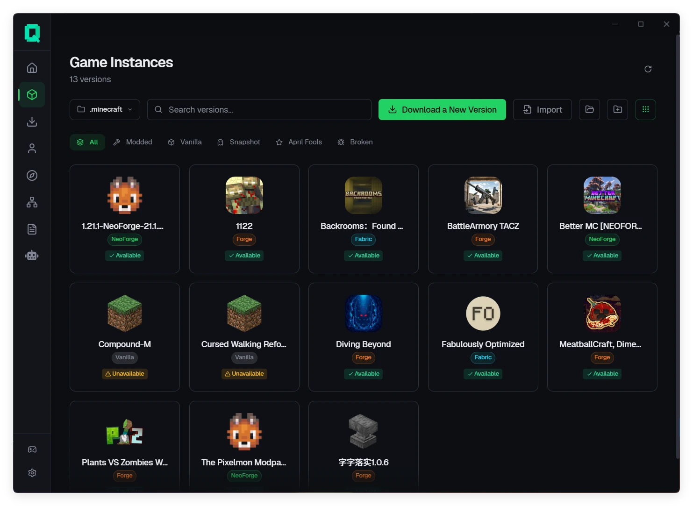 | 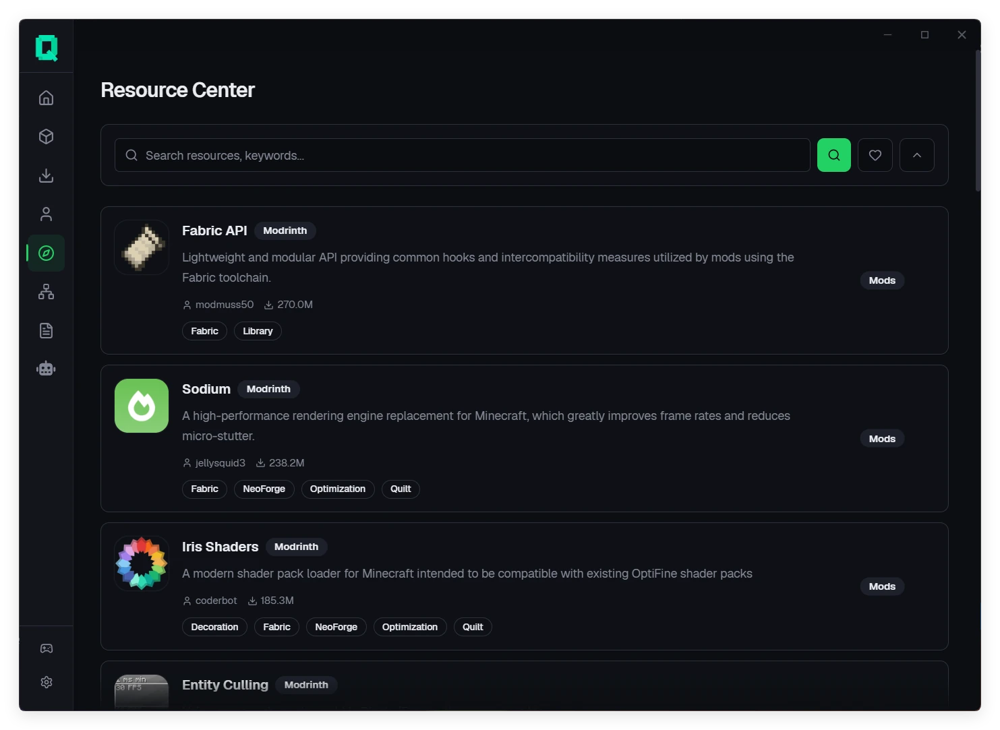 |
| 實例隔離，獨立設定與分組 | Modrinth、CurseForge、FTB、Technic 統一搜尋 |

| 實例詳情 | 下載管理 |
|:---:|:---:|
| 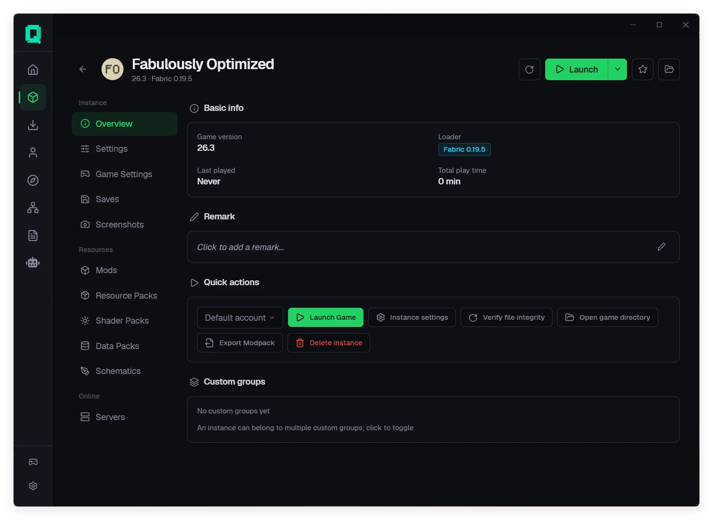 | 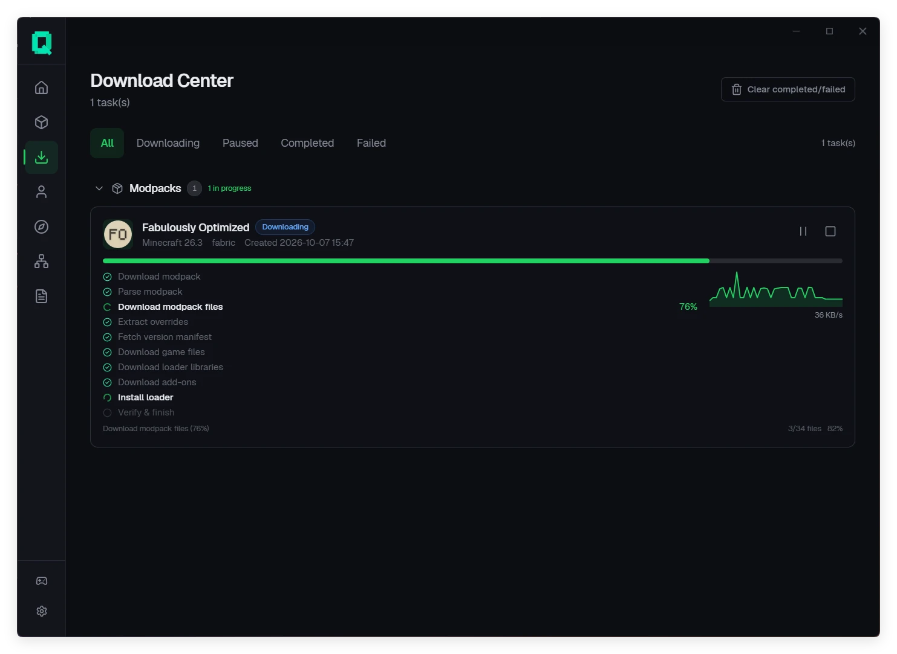 |
| 模組、存檔、光影、投影與伺服器管理 | 下載進度、暫停續傳與失敗重試 |

| 地圖預覽 | 存檔設定 |
|:---:|:---:|
| 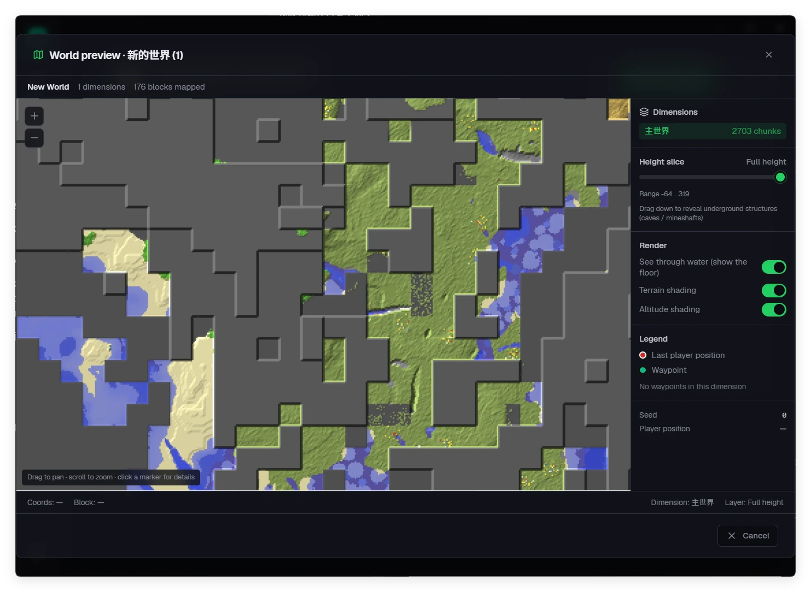 | 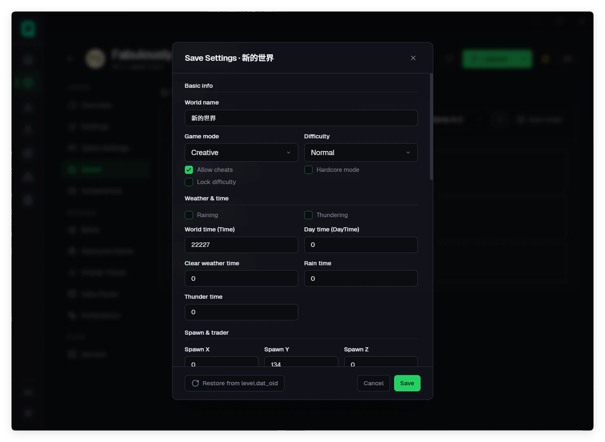 |
| 已探索區域與地下結構 | 直接修改 `level.dat` |

| 投影預覽 | 前置依賴安裝 |
|:---:|:---:|
| 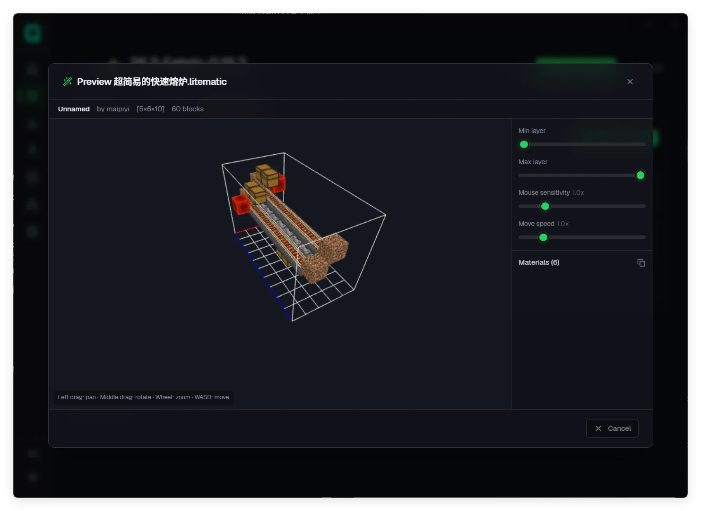 | 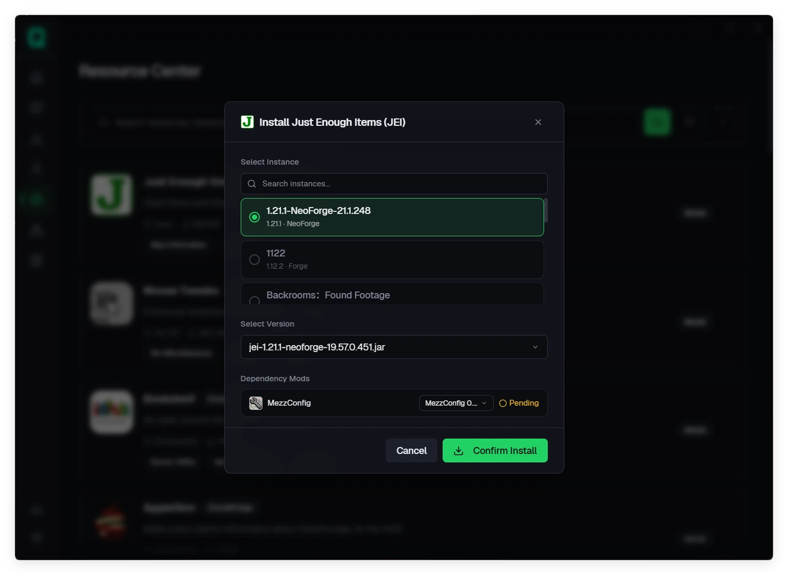 |
| `.litematic` 3D 預覽與材料統計 | 自動偵測並安裝模組前置 |

| 多人連線 | 帳號管理 |
|:---:|:---:|
| 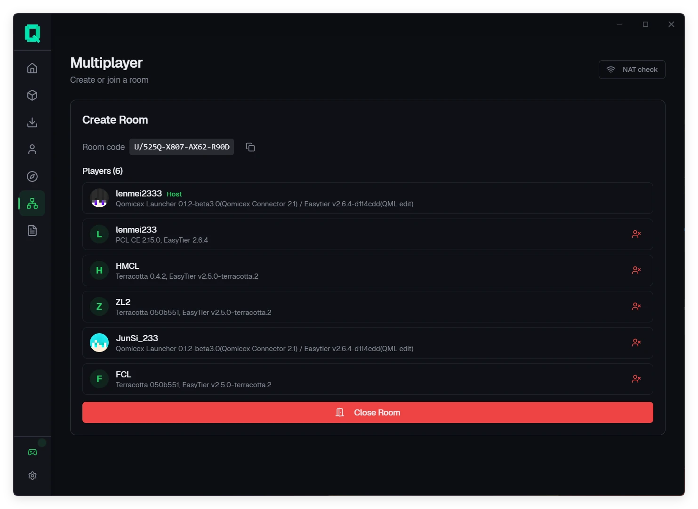 | 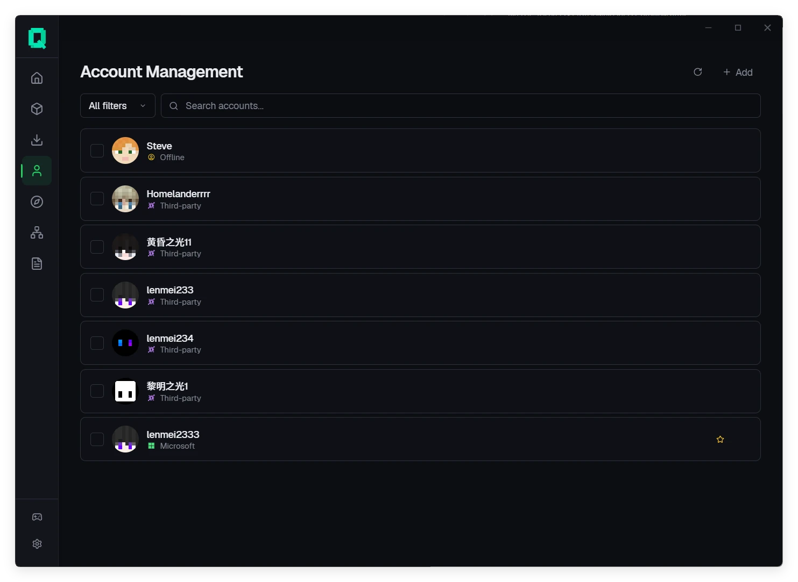 |
| 房間碼加入，成員管理 | 支援多種帳號類型 |

| 版本列表 | 遊戲設定 |
|:---:|:---:|
| 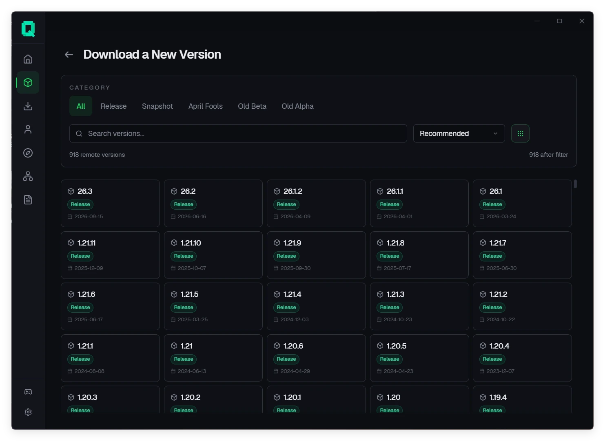 | 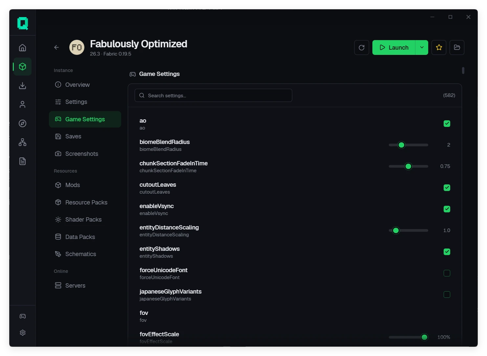 |
| 依版本類型與載入器篩選 | 搜尋式編輯遊戲設定 |

---

## 支援平台

| 平台 | 架構 | 最低系統需求 | 安裝檔 |
|:---|:---|:---|:---|
| **Windows** | `x64`, `ARM64` | Windows 10 (1809+) | `.exe` |
| **macOS** | `x64`, `ARM64` | macOS 10.15+ | `.dmg` |
| **Linux** | `x64`, `ARM64` | Ubuntu 20.04+ / glibc 2.28+ | `.AppImage`、`.deb`、`.rpm` |

---

## 下載

從[官網下載頁](https://www.qomicex.top/download)或 [GitHub Releases](https://github.com/Qomicex-Public/Qomicex.Tauri/releases/latest) 取得對應平台的安裝檔。

- 正式版與測試版分通道發佈，可在設定中切換
- 啟動器支援自動更新
- Windows 需要 WebView2 執行環境，Windows 11 已內建

---

## 從原始碼建置

需要 Node.js 22+、pnpm 11+，以及 `rust-toolchain.toml` 指定的 Rust 工具鏈。

```bash
pnpm install --frozen-lockfile
pnpm --filter @qomicex/plugin-ui build
pnpm run tauri dev     # 開發
pnpm exec tauri build  # 打包
```

後端可單獨啟動，開發時前端透過 `:5000` 直連：

```bash
cargo run --manifest-path src-backend/qomicex-backend/Cargo.toml
```

開發慣例與目錄結構見 [AGENTS.md](AGENTS.md) 與 [CONTRIBUTING.md](CONTRIBUTING.md)。

---

## 參與貢獻

- 回報問題或功能建議：[Issues](https://github.com/Qomicex-Public/Qomicex.Tauri/issues)，請附版本號、系統版本與日誌
- 開發外掛：[外掛系統 API](docs/junsi-dev-docs/3-API规范/插件系统API.md)
- 參與翻譯：見倉庫內的語言檔
- 交流反饋：[QQ 群](https://qm.qq.com/q/rKiwzrkg8w)

---

## 關聯專案

- **[qomicex-core-rust](https://github.com/Qomicex-Public/qomicex-core-rust)**：啟動器核心邏輯
- **[qomicex-downloader-rust](https://github.com/Qomicex-Public/qomicex-downloader-rust)**：下載引擎
- **[qomicex-connector-rust](https://github.com/Qomicex-Public/qomicex-connector-rust)**：連線網路
- **[EuoraCraft-Launcher](https://github.com/ECLteam/EuoraCraft-Launcher)**：共用連線節點，跨啟動器互通

---

## Star 成長趨勢

<a href="https://www.star-history.com/?repos=Qomicex-Public%2FQomicex.Tauri&type=date&legend=bottom-right">
 <picture>
   <source media="(prefers-color-scheme: dark)" srcset="https://api.star-history.com/chart?repos=Qomicex-Public/Qomicex.Tauri&type=date&theme=dark&legend=bottom-right&sealed_token=3kRKTiCGJWMYcUcMNuRameNqf5F2KOLMXywaK7Sxym5ZUX3u2Jh3yAam-_le6HA2Jb2oLupvmK1VlTarzTSBkPWaKb7z5gnA7hkq0ZLXwEaAxPsH1o0GQg" />
   <source media="(prefers-color-scheme: light)" srcset="https://api.star-history.com/chart?repos=Qomicex-Public/Qomicex.Tauri&type=date&legend=bottom-right&sealed_token=3kRKTiCGJWMYcUcMNuRameNqf5F2KOLMXywaK7Sxym5ZUX3u2Jh3yAam-_le6HA2Jb2oLupvmK1VlTarzTSBkPWaKb7z5gnA7hkq0ZLXwEaAxPsH1o0GQg" />
   
 </picture>
</a>

---

## 貢獻者

感謝所有為 Qomicex Launcher 做出貢獻的人。

<a href="https://github.com/Qomicex-Public/Qomicex.Tauri/graphs/contributors">
  
</a>

---

## 發音與授權

- **讀音**：Qomicex `/kˈɑːmaɪsˌɛks/`（q·om·ic·ex）
- **授權**：[GPLv3](LICENSE)

### 合規聲明

- 遊戲檔案從 Mojang 官方伺服器及其公開鏡像下載。本專案不託管、不轉存 Minecraft 遊戲本體。
- Qomicex Launcher 是第三方工具，與 Mojang、Microsoft、網易無隸屬、背書或贊助關係。
- 離線帳號僅用於離線遊戲與自建伺服器。在要求正版驗證的伺服器上使用離線帳號可能違反該伺服器的規則。
- 新增離線帳號或第三方帳號前，需先登入 Microsoft 帳號。
