**English** | [简体中文](README-ZH_CN.md) | [繁體中文](README-ZH_TW.md) | [日本語](README-JA_JP.md) | [Русский](README-RU_RU.md)

<div align="center">


# Qomicex Launcher

**A Minecraft launcher with plugin support**

Instance management, resource downloads, world previews and multiplayer. Available for Windows, macOS and Linux, licensed under GPLv3.

[](https://github.com/Qomicex-Public/Qomicex.Tauri/)
[](https://github.com/Qomicex-Public/Qomicex.Tauri/releases)
[](https://github.com/Qomicex-Public/Qomicex.Tauri/releases)
[](https://github.com/Qomicex-Public/Qomicex.Tauri/releases)
[](https://github.com/Qomicex-Public/Qomicex.Tauri/actions)
[](LICENSE)

[**Download**](https://www.qomicex.top/download) · [Website](https://www.qomicex.top) · [Docs](https://docs.qomicex.top) · [Plugin Store](https://plugins.qomicex.top) · [QQ Group](https://qm.qq.com/q/rKiwzrkg8w) · [Afdian](https://afdian.com/a/QomicexLauncher)

<a href="https://www.qomicex.top">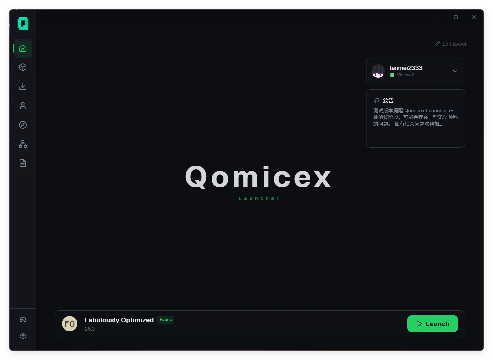</a>

</div>

---

## Overview

| Item | Details |
|:---|:---|
| Platforms | Windows, macOS and Linux, with x64 and ARM64 builds |
| Loaders | Vanilla, Forge, NeoForge, Fabric, Quilt, LiteLoader, OptiFine, Cleanroom |
| Content platforms | Modrinth, CurseForge, FTB, Technic, MCMod |
| Languages | Simplified Chinese, Traditional Chinese, English, Japanese, Russian |
| Installer | About 19 MB for Windows |

---

## Features

### Plugins

Third-party plugins can be installed to extend the interface and functionality.

- Plugins can add pages, overlay windows, menu entries, themes and dashboard widgets
- The plugin store provides browsing, installation, updates and ratings
- A component library and command-line tool are available for plugin development

### World preview

Save data can be viewed without starting the game.

- **World map**: shows the explored area of a save, with a height filter for caves and underground structures
- **Waypoints**: shows waypoints from JourneyMap, Xaero's Minimap and VoxelMap, together with player positions
- **Schematic preview**: opens `.litematic` files in 3D, with layer clipping and a material list
- **World settings**: edits world name, game mode, difficulty, cheats and hardcore mode

### Multiplayer

- P2P multiplayer without a public IP address or port forwarding, joined by room code
- Hosts can view the member list and remove members
- Players on other launchers can join the same room

### Instances and accounts

- Instances are isolated, each with its own mods, saves, settings and launch arguments
- Instances can be grouped, given custom icons, imported and exported
- Supports Microsoft accounts, LittleSkin and offline accounts
- Checks the Java runtime before launch and offers to download a missing version

### Resources and downloads

- Search and install mods, modpacks, resource packs and shaders in the launcher
- Detects and installs required dependencies when installing a mod
- Separate download sources can be selected for game files and mod files
- Multi-threaded segmented downloads with pause and resume
- Supports system and custom proxies

### Modpacks

- Imports CurseForge, Modrinth, FTB, Technic and MultiMC modpacks
- Exports to CurseForge zip or Modrinth mrpack
- Failed modpack updates roll back automatically without deleting the instance

### Appearance

- Dark, light and system themes
- Custom accent colour, frosted glass and liquid glass surfaces
- Image, animated image and video backgrounds
- Custom fonts and theme packs
- Dashboard widgets can be arranged freely

### Other

- **Crash analysis**: classifies a pasted log by problem type and identifies the mod involved
- **Mod updates**: checks installed mods for new versions in batches
- **Favorites**: folders, notes and tags, with group installation
- **Logs**: live output during launch, with automatic saving and export
- **Automatic updates**: downloaded in the background and installed on the next start
- **Page sharing**: `qomicex-launcher://` links open an instance directly
- **Local data**: settings and instances are stored locally and can be backed up or moved

---

## Screenshots

| Instances | Resource center |
|:---:|:---:|
| 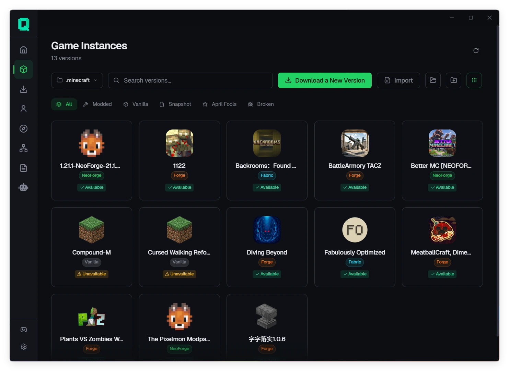 | 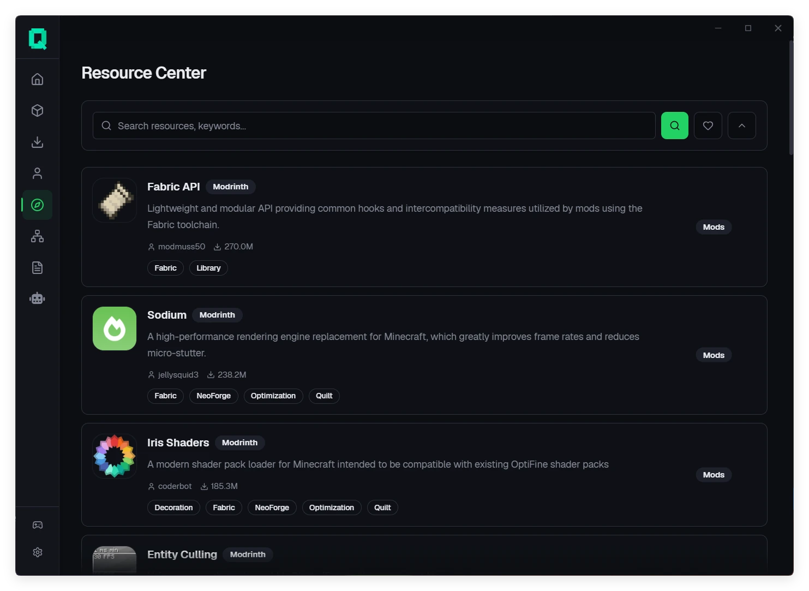 |
| Isolated instances with their own settings and groups | Unified search across Modrinth, CurseForge, FTB and Technic |

| Instance detail | Downloads |
|:---:|:---:|
| 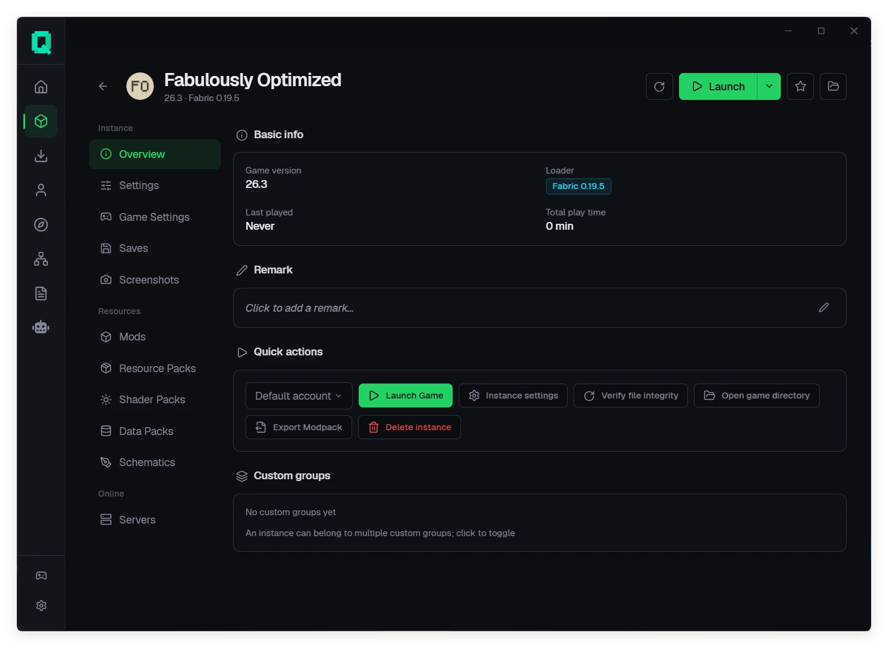 | 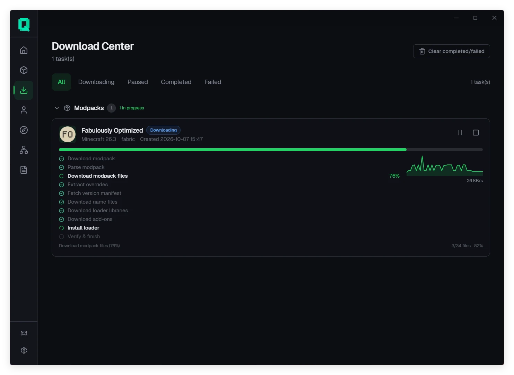 |
| Mods, saves, shaders, schematics and servers | Progress, pause and resume, retry |

| World map | World settings |
|:---:|:---:|
| 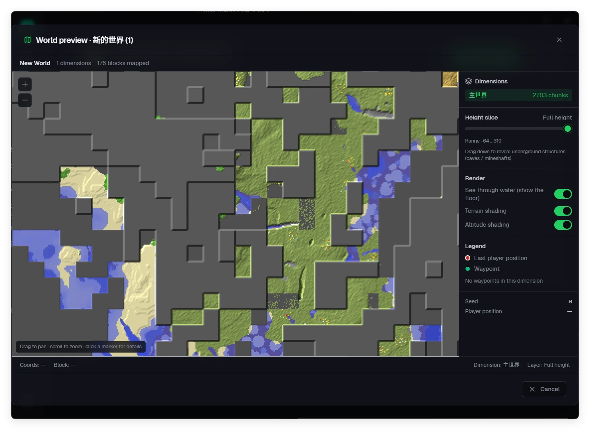 | 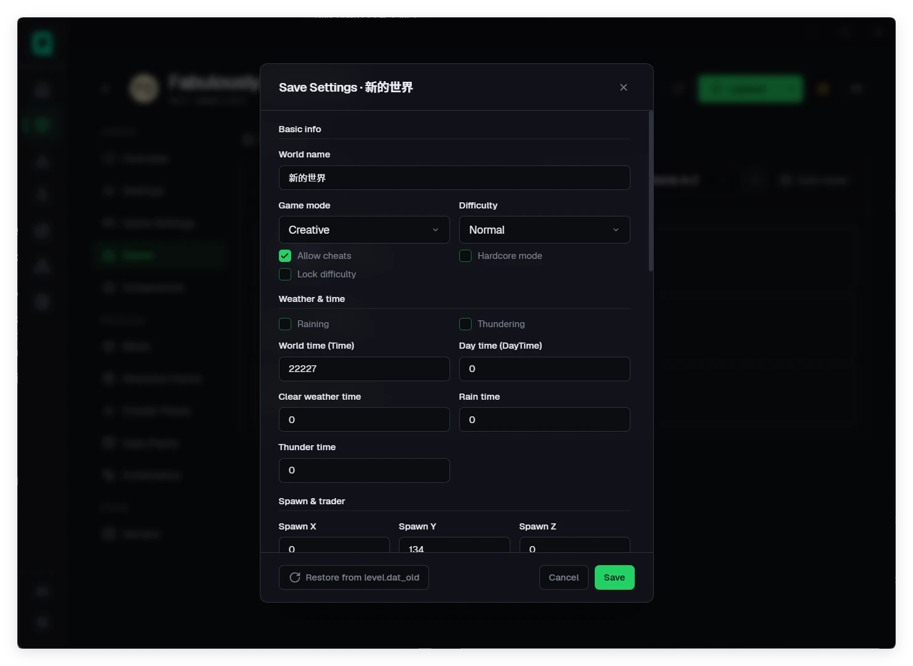 |
| Explored area and underground structures | Edits `level.dat` directly |

| Schematic preview | Dependencies |
|:---:|:---:|
| 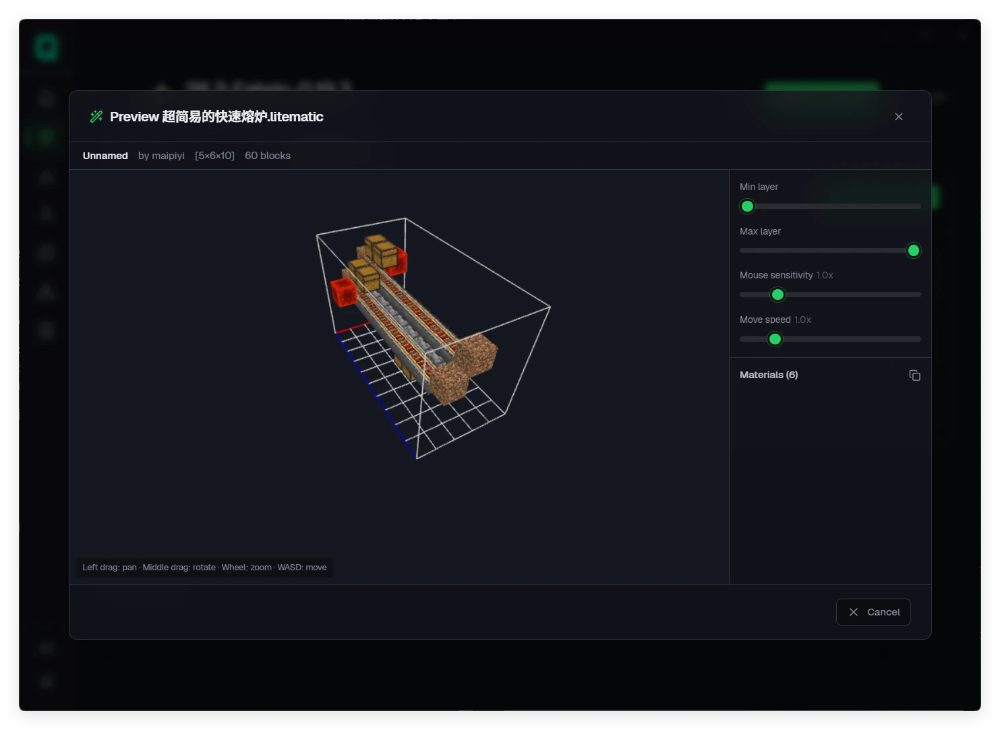 | 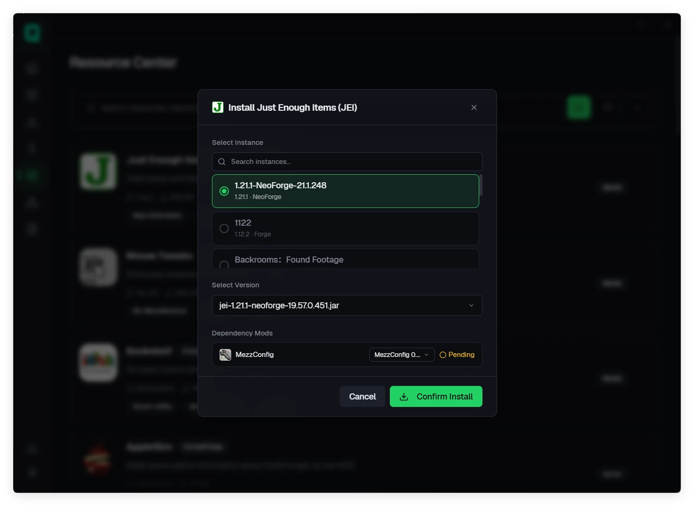 |
| 3D preview and material list for `.litematic` | Detects and installs mod dependencies |

| Multiplayer | Accounts |
|:---:|:---:|
| 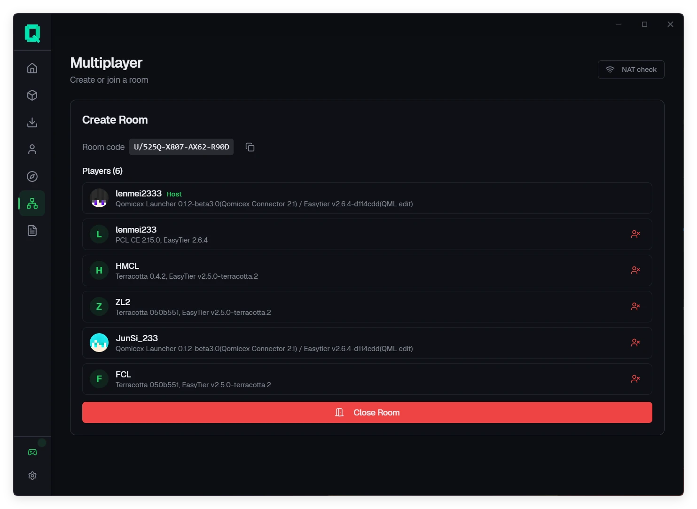 | 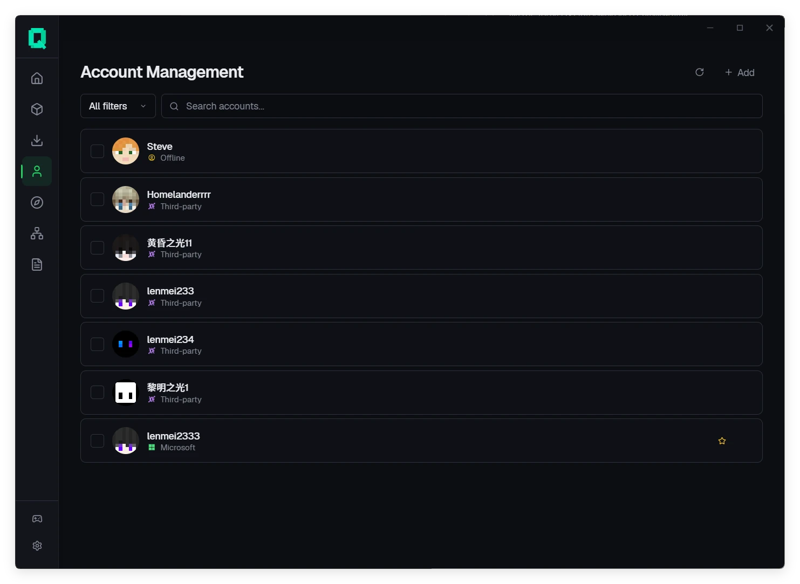 |
| Room codes and member management | Multiple account types |

| Version list | Game settings |
|:---:|:---:|
| 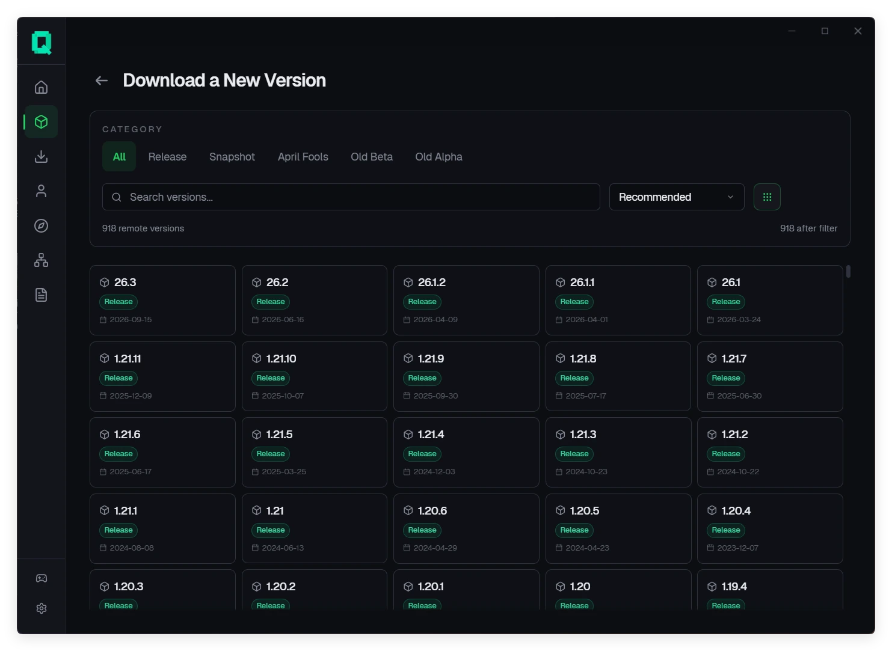 | 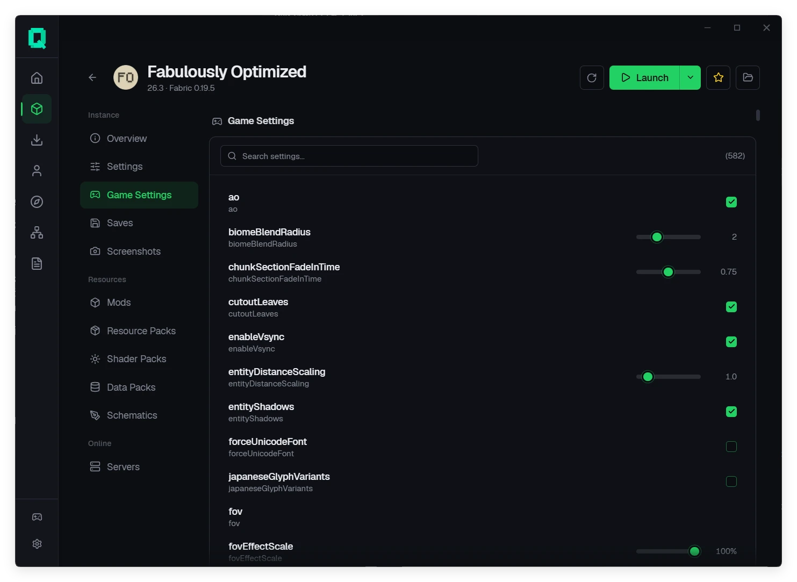 |
| Filter by release type and loader | Searchable editing of game settings |

---

## Platform support

| Platform | Architectures | Minimum OS | Package |
|:---|:---|:---|:---|
| **Windows** | `x64`, `ARM64` | Windows 10 (1809+) | `.exe` |
| **macOS** | `x64`, `ARM64` | macOS 10.15+ | `.dmg` |
| **Linux** | `x64`, `ARM64` | Ubuntu 20.04+ / glibc 2.28+ | `.AppImage`, `.deb`, `.rpm` |

---

## Download

Get the installer for your platform from the [download page](https://www.qomicex.top/download) or [GitHub Releases](https://github.com/Qomicex-Public/Qomicex.Tauri/releases/latest).

- Stable and beta releases are published on separate channels, switchable in settings
- The launcher updates itself
- Windows requires the WebView2 runtime, which is included with Windows 11

---

## Build from source

Requires Node.js 22+, pnpm 11+ and the Rust toolchain pinned in `rust-toolchain.toml`.

```bash
pnpm install --frozen-lockfile
pnpm --filter @qomicex/plugin-ui build
pnpm run tauri dev     # develop
pnpm exec tauri build  # package
```

The backend can run separately; during development the frontend connects to `:5000` directly.

```bash
cargo run --manifest-path src-backend/qomicex-backend/Cargo.toml
```

Development conventions and directory structure are described in [AGENTS.md](AGENTS.md) and [CONTRIBUTING.md](CONTRIBUTING.md).

---

## Contributing

- Report issues or suggest features in [Issues](https://github.com/Qomicex-Public/Qomicex.Tauri/issues); include the version, OS and logs
- Plugin development: [Plugin API](docs/junsi-dev-docs/3-API规范/插件系统API.md)
- Translations: see the language files in the repository
- Chat: [QQ group](https://qm.qq.com/q/rKiwzrkg8w)

---

## Related projects

- **[qomicex-core-rust](https://github.com/Qomicex-Public/qomicex-core-rust)**: core launcher logic
- **[qomicex-downloader-rust](https://github.com/Qomicex-Public/qomicex-downloader-rust)**: download engine
- **[qomicex-connector-rust](https://github.com/Qomicex-Public/qomicex-connector-rust)**: multiplayer networking
- **[EuoraCraft-Launcher](https://github.com/ECLteam/EuoraCraft-Launcher)**: shared multiplayer nodes and cross-launcher compatibility

---

## Star history

<a href="https://www.star-history.com/?repos=Qomicex-Public%2FQomicex.Tauri&type=date&legend=bottom-right">
 <picture>
   <source media="(prefers-color-scheme: dark)" srcset="https://api.star-history.com/chart?repos=Qomicex-Public/Qomicex.Tauri&type=date&theme=dark&legend=bottom-right&sealed_token=3kRKTiCGJWMYcUcMNuRameNqf5F2KOLMXywaK7Sxym5ZUX3u2Jh3yAam-_le6HA2Jb2oLupvmK1VlTarzTSBkPWaKb7z5gnA7hkq0ZLXwEaAxPsH1o0GQg" />
   <source media="(prefers-color-scheme: light)" srcset="https://api.star-history.com/chart?repos=Qomicex-Public/Qomicex.Tauri&type=date&legend=bottom-right&sealed_token=3kRKTiCGJWMYcUcMNuRameNqf5F2KOLMXywaK7Sxym5ZUX3u2Jh3yAam-_le6HA2Jb2oLupvmK1VlTarzTSBkPWaKb7z5gnA7hkq0ZLXwEaAxPsH1o0GQg" />
   
 </picture>
</a>

---

## Contributors

Thanks to everyone who has contributed to Qomicex Launcher.

<a href="https://github.com/Qomicex-Public/Qomicex.Tauri/graphs/contributors">
  
</a>

---

## Pronunciation and license

- **Pronunciation**: Qomicex `/kˈɑːmaɪsˌɛks/` (q·om·ic·ex)
- **License**: [GPLv3](LICENSE)

### Legal notice

- Game files are downloaded from Mojang's official servers and their public mirrors. This project does not host or redistribute Minecraft itself.
- Qomicex Launcher is a third-party tool. It is not affiliated with, endorsed by, or sponsored by Mojang, Microsoft or NetEase.
- Offline accounts are intended for offline play and self-hosted servers. Using an offline account on servers that require authentication may violate those servers' rules.
- A Microsoft account must be signed in before offline or third-party accounts can be added.
